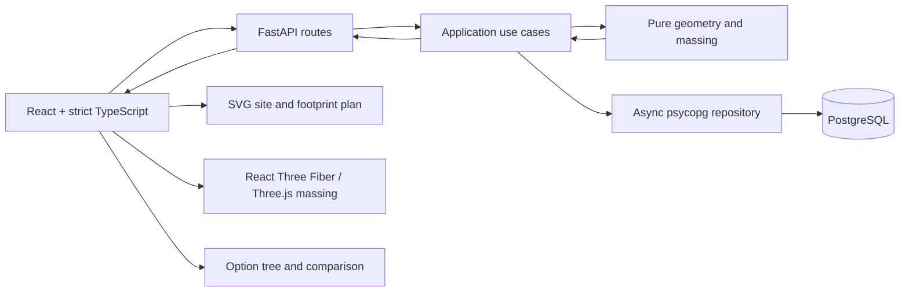

# Design note

> The application currently provides the health endpoint, configuration, async
> database-pool plumbing, sample sites, a tested TypeScript frontend scaffold, and
> pure site geometry, setbacks, and component selection. Massing, persistence, and
> visualization functionality in this design remains planned.

## Problem interpretation

The application turns one planar site polygon and building rules into a reproducible
massing option. The assignment requires generation, visualization, persistence, and
decision-tree branching, navigation, and comparison. It leaves the rendering approach
open. This design commits to both an SVG plan and an interactive 3D massing view:
complementary views of the same backend result, with both included in delivery scope.

The MVP produces one connected building. When setbacks split the site, the engine
preserves the complete buildable geometry, selects its largest connected component,
and reports the selection. Coordinates are
local metres; geographic conversion, richer zoning, authentication, multi-user
permissions, and background jobs are outside scope.

## Domain model

### Entities

- **SiteGeometry:** a valid, positive-area GeoJSON-style `Polygon`, optionally with
  holes. Coordinates are finite `(x, y)` metres; request rings are closed and
  orientation is normalized. Results support `MultiPolygon` setbacks; direct
  MultiPolygon site input is deferred.
- **HardConstraints:** non-negative `setback_m`, positive `floor_to_floor_m`, optional
  positive `max_height_m` and optional positive integer `max_floors`. Optional area
  limits are `site_coverage_ratio` in `(0, 1]` and positive `max_footprint_m2`.
  At least one height/floor limit is required.
- **DesignPreferences:** optional positive integer `preferred_floor_count` and
  positive `preferred_footprint_area_m2`; explicit choices subordinate to hard limits.
- **DesignTargets:** optional non-negative `gfa_target_m2`, a desired minimum, not a
  hard constraint or exact optimization objective.
- **MassingResult:** input/context geometry, generated default and actual footprint,
  repeated floor plate, metrics, preference outcomes, and feasibility. Hard upper
  bounds, demonstrated construction capacity, and actual preferred results are distinct.
- **Option:** immutable snapshot of inputs, result, schema/algorithm versions, and
  optional parent. A branch inherits the parent site, recomputes a complete new
  configuration, and inserts a child; it never updates its parent.
- **Diagnostic:** stable code, severity, message, and optional field/metric details.

### Measurement and invariants

The geometry engine measures polygon area as exterior area minus holes. Site area
uses the original boundary; `buildable_area_m2` sums all setback components, while
`selected_buildable_area_m2` measures only the component used for construction.
`footprint_area_m2` measures the actual resulting polygon, including any reduction
for coverage or preferences. Actual site coverage is `footprint_area_m2 / site_area_m2`;
the input `site_coverage_ratio` is its optional maximum, not the achieved value.

`floor_to_floor_m` is the uniform vertical spacing between successive floors.
The algorithm below derives the maximum permitted count from height/floor limits,
then selects the actual count. For repeated plates, GFA sums gross floor areas
without deductions for circulation or usable-space efficiency.

The footprint must be valid, positive, contained within the selected setback
component, and within all supplied area limits, using the numerical policy below.
Serialized geometry and reported area must agree. For a valid building:

- `height_m = floor_count * floor_to_floor_m`;
- `gfa_m2 = footprint_area_m2 * floor_count`;
- floor count is positive and respects both supplied height and floor limits.

A valid building may miss a target. A failed construction has no invented building
geometry or metrics. Snapshots retain every input and version needed for reproduction.

### Responsibilities and boundaries

FastAPI, PostgreSQL, async psycopg, and React are retained from the assignment scaffold.



Transport owns Pydantic contracts, versioning, and error translation; no geometry or
SQL. Application use cases coordinate preview, save, branch, tree, and comparison.
Pure domain services separate polygon operations from massing rules and depend on
neither HTTP nor persistence. Repositories own parameterized SQL, transactions, and
snapshot mapping; no ORM. The frontend owns drafts, interaction, and rendering;
geometry, floor count, height, area, GFA, and feasibility remain server-authoritative.

## Algorithm

### Geometry library and validation

[Shapely/GEOS](https://shapely.readthedocs.io/en/stable/reference/shapely.buffer.html)
provides validity, buffering, holes, and containment without requiring a database in
domain tests. Custom NumPy geometry would still require robust topology and offsets.
[Clipper2](https://www.angusj.com/clipper2/Docs/Overview.htm) offers integer-based
robustness but adds coordinate-scaling and Python-binding choices. PostGIS would
couple previews and geometry tests to PostgreSQL. GEOS floating-point behavior still
requires version pinning and numerical checks; successful buffering does not establish
optimality.

Validation covers types/bounds, finite coordinates, closed rings with at least three
unique points, positive area, and polygon validity. Self-intersections and collapsed
rings are rejected rather than silently repaired; orientation is normalized and
double-precision coordinates are preserved. Basic validation precedes hard
feasibility, then preference checks against calculated limits. Unsuccessful
construction is a domain outcome.

#### Implemented site geometry foundation

`app/geometry/site.py` exposes pure functions through `app.geometry`:
`parse_site_geometry` returns a normalized Shapely `Polygon`,
`serialize_site_geometry` returns a typed `PolygonGeoJSON` dictionary, and
`site_area_m2` measures exterior area minus holes. `normalize_polygon` validates
and applies the same canonicalization to directly supplied polygons, including
generated setback components. A Shapely polygon is the domain
value; no separate geometry wrapper, HTTP model, or database dependency is needed.
`InvalidSiteGeometry` carries a message and input path for later transport translation.

The parser accepts a Polygon mapping with list/tuple coordinate arrays. Positions
must contain exactly two finite numeric ordinates; booleans and numeric strings
are rejected. Every ring needs at least three distinct vertices, exact closure in
the original numeric input, and finite positive area. The complete polygon must
have valid GEOS topology and finite positive area. Hole validity follows GEOS rules,
including valid single-point contacts. Empty geometry and direct MultiPolygon input
are rejected. Serialization and measurement also validate directly supplied Shapely
polygons, including rejecting Z/M dimensions. Validation never closes, snaps, or
repairs input geometry.

After validation, canonicalization removes exact consecutive duplicate positions
from exterior and interior rings using tuple equality (`itertools.groupby`). This
includes extra adjacent copies of the closing position and makes ring rotations
deterministic. All other coordinates, including distinct nearby and collinear
vertices, are retained. `shapely.remove_repeated_points(..., tolerance=0)` was
evaluated on the pinned engine, but it also removed a distinct `(1e-170, 0)` vertex;
exact equality avoids that coordinate loss without a geometric tolerance or repair.
Canonicalization then uses Shapely's
[`normalize`](https://shapely.readthedocs.io/en/stable/reference/shapely.normalize.html)
for consistent ring starts and hole ordering, followed by
[`orient_polygons`](https://shapely.readthedocs.io/en/stable/reference/shapely.orient_polygons.html)
for counter-clockwise exterior and clockwise interior rings. Serialization emits
closed list rings, normalizes signed zero, and performs no decimal rounding or
precision-grid reduction. Only exact consecutive duplicates are removed.
Coordinates use GEOS binary64 precision; large offsets or extremely small features
remain subject to floating-point limitations. Positivity and ring closure do not use
the later comparison tolerance, so there is no arbitrary minimum site area.

`pyproject.toml` pins Shapely **2.2.0**; `uv.lock` also locks its required NumPy
dependency to **2.5.4**. The local Python 3.12.14 macOS arm64 wheel installation reports
GEOS **3.14.1**. NumPy is transitive; the domain uses Shapely operations without custom
NumPy algorithms. GEOS is bundled with Shapely wheels rather than resolved as a
separate Python package; source builds can link a different GEOS version. Reproduction
should record both `shapely.__version__` and `shapely.geos_version_string`; identical
results across different engine versions are not guaranteed.

Tests close copies of the supplied open vertex-list fixtures before parsing, checking
rectangle, L-shaped, and notched areas of 1000, 900, and 860 m² respectively. Additional
cases cover holes, invalid topology/coordinates, tiny positive sites, deterministic
ordering, and exact coordinate/area preservation through JSON round trips.

### Setbacks and floor limits

```python
buildable = site.buffer(-setback_m, join_style="mitre", mitre_limit=5)
```

Mitred joins preserve rectilinear corners; the limit bounds acute-angle spikes.
The result is normalized to valid Polygon, MultiPolygon, or empty geometry. The engine
preserves complete `buildable_geometry` and selects its largest positive-area component,
breaking ties by lexicographic bounding box then normalized serialized coordinates.
The response includes component count, retained/discarded area, and selection
diagnostics. Rejecting every split would discard useful sites; using every component
would introduce multi-building allocation.

#### Implemented setbacks and component selection

`app/geometry/setbacks.py` implements `calculate_setback(site, setback_m)` as a pure
function returning a frozen `SetbackResult`. The site is validated before buffering;
the distance must be a finite, non-negative numeric value, excluding booleans and
numeric strings. Invalid distances raise `InvalidSetback`. Zero setback bypasses
`buffer(0)` to preserve the foundation's canonical representation, including distinct
collinear vertices. Positive distances use the mitred inward buffer above.

The result keeps the complete Shapely Polygon/MultiPolygon and a separate selected
Polygon. It reports original site area, total buildable area, selected area, component
count, and discarded area in square metres; retained area aliases selected area.
Discarded area sums unselected components directly to avoid losing tiny components
through subtraction. An empty result contains an empty Polygon, selected geometry
`None`, zero buildable/selected/retained/discarded areas, and zero components. The
original site area remains available.

`select_largest_component` accepts valid positive-area Polygon candidates and ignores
empty polygons. Components use exact descending computed area, then ascending bounds,
then canonical numeric coordinate arrays. Comparison tolerance does not turn unequal
areas into ties or discard positive components. `normalize_polygon` and
`serialize_site_geometry` supply the existing normalization policy for every component.
`serialize_buildable_geometry` emits a Polygon or MultiPolygon dictionary with parts
in the same deterministic order; empty regions serialize as `None`. Buildable
geometry retains every strictly positive measured component, with no minimum area
cutoff.

Diagnostics use stable code, severity, and message fields:
`EMPTY_BUILDABLE_REGION` (`info`) and `BUILDABLE_REGION_SPLIT` (`warning`). They describe
geometry outcomes without introducing massing feasibility statuses. Invalid generated
geometry, non-finite measurements, or invariant failures raise errors rather than
being converted into empty-region diagnostics. Area conservation and non-growth use
the centralized comparison tolerance described below and implemented in
`app/geometry/tolerances.py`; they do not modify returned geometry. Nonempty output
must satisfy `site.covers(buildable)`, which permits shared boundary points. Any
spatial escape is an invariant failure regardless of its area; an outside-area
threshold alone cannot bound displacement. No containment relaxation is applied.

The pinned GEOS 3.14.1 engine can collapse or reshape extremely thin regions before
their ideal mathematical area reaches zero. For a 20 × 10 m rectangle and a 4.99995 m
setback, it returns a valid contained triangle of approximately 0.000500005 m² rather
than the ideal thin rectangle of approximately 0.00100001 m². A unit square inset by
0.499995 m returns empty despite an ideal positive area near 1e-10 m². Tests preserve
positive output below the comparison tolerance and verify ordinary analytical inset
geometry. These near-collapse results are reported as produced by GEOS, without
snapping, a custom repair, or a claim of exact mathematical erosion at every scale.

Let `N = maximum_permitted_floor_count`: use `floor(max_height_m / floor_to_floor_m)`
for height alone, `max_floors` for count alone, or their minimum for both. Never round
up past a height cap. Both limits absent is invalid input; a valid positive height
allowing zero floors is `infeasible`, checked before rejecting a positive floor
preference against zero capacity.

### Area bounds and deterministic construction

`U = footprint_area_upper_bound_m2` is the minimum of the largest setback component's
area, supplied `site_area_m2 * site_coverage_ratio`, and supplied `max_footprint_m2`.
`gfa_upper_bound_m2 = U * N`. These are necessary hard upper bounds under the adopted
single-building, setback, and repeated-plate conventions, not promises of attainable
geometry.

The engine uses the selected component when its area fits `U`; otherwise it searches
inward-buffer distances with a fixed iteration budget. Each distance applies to the
original selected component. After validation and largest-component selection using
the same tie-break, the search retains the largest valid candidate actually generated
at/below `U`, reporting secondary splits, discarded area, and undershoot.

This default is `generated_footprint_geometry`, with `generated_footprint_area_m2` and
`generated_gfa_capacity_m2 = generated_footprint_area_m2 * N`. Capacity demonstrates
one attainable construction; it is not the maximum permitted by hard constraints.
If no positive valid default is generated despite positive buildable area and floors,
the result is `generation_failed` / `FOOTPRINT_NOT_GENERATED`; capacity is unknown
(`null`), not zero.

A dumbbell of two 20 × 20 m lobes joined by a 2 m corridor illustrates the limitation:
a 350 m² cap may yield a split buffered component around 324 m² although a connected
350 m² rectangle fits within one lobe. These dimensions are explanatory, not measured
GEOS output. Failure of this heuristic does not prove geometric impossibility.

Inward buffering reuses a mature operation, reduces search to one dimension, and
supports direct containment checks. Centroid scaling can escape concave regions;
axis clipping adds an arbitrary direction and can split; inscribed rectangles
restrict shapes; general optimization adds objectives and complexity. The MVP accepts
and reports undershoot without adding an optimizer.

### Preferences and floor selection

A floor preference is an exact discrete choice: exceeding `N` returns
`422 PREFERENCE_EXCEEDS_HARD_LIMIT` rather than silently changing it. Area is a
continuous construction request already subject to approximation. For requested
area `R`, the engine searches the original selected component with target `min(R, U)`;
`PREFERENCE_CLAMPED_TO_HARD_CAP` applies only when `R > U` beyond tolerance.
An area request within `U` but above `generated_footprint_area_m2` is not a hard-cap
violation.

Area results retain `requested`, `effective`, `actual`, and signed
`difference_m2 = actual - requested`. Positive candidates are `met` within tolerance,
`clamped` for requests above `U`, otherwise `approximated`; clamped results also expose
effective-target undershoot. `FOOTPRINT_AREA_APPROXIMATED` reports construction
discrepancies. If preferred construction produces no positive polygon, the result is
`generation_failed` / `PREFERRED_FOOTPRINT_NOT_GENERATED`, with preference status
`unmet` and actual area null. Context, bounds, and known default capacity remain
available; the default never silently replaces the request.

Without a floor preference, the engine uses `N` when the target is absent or zero.
For a positive target, it chooses the smallest positive count at/below `N` meeting it
with the actual plate; otherwise it uses `N` and reports shortfall. Without an area
preference, it uses the generated default footprint. Explicit valid preferences remain
unchanged even when the target is missed.

### Feasibility and targets

| Status | Meaning | `hard_constraints_satisfied` |
|---|---|---|
| `feasible` | Positive valid building; target met or absent. | `true` |
| `feasible_target_unmet` | Positive valid building; target missed. | `true` |
| `infeasible` | Empty setback region or no permitted floor. | `false` |
| `generation_failed` | Positive region/floors, but construction yielded no valid positive footprint; no proof of hard infeasibility. | `null` |

Empty setbacks report `EMPTY_BUILDABLE_REGION`.

For a valid building with an unmet target, classify in order using tolerance:

1. `TARGET_EXCEEDS_UPPER_BOUND`: target exceeds `gfa_upper_bound_m2`; unreachable
   under the documented hard constraints and model, although the building remains valid.
2. `TARGET_BEYOND_GENERATED_CAPACITY`: within the upper bound but above generated
   capacity; another footprint may work.
3. `TARGET_UNMET_WITH_PREFERENCES`: default capacity suffices, but the actual selected
   configuration falls short. This diagnoses the result without inferring user intent.

Target status is `not_requested` when absent, `met`/`unmet` for positive buildings,
and `not_evaluated` for supplied targets without a building. Zero is met only with a
positive building.

### Numerical policy and alternatives

Comparisons use centralized scale-aware tolerances: initially area tolerance
`max(1e-8, 1e-9 * max(site_area_m2, 1))`, length tolerance derived from extent, and GFA
tolerance propagated through `N`. The same target predicate governs floor selection
and status; when a minimum count exceeds one, the preceding count must fail it.
Tolerance cannot bridge material capacity gaps or certify ungenerated geometry;
adjustments require fixture evidence.

After the manual save/branch workflow works, optional bounded suggestions enumerate
counts `1..N`, request `target / count` area for positive targets, otherwise use the
default footprint. Suggestions reuse construction/validation, have a count cap, and
are deduplicated by count and area tolerance. Failed candidates are reported as
skipped; an empty suggestion set does not prove infeasibility. Suggestions remain
unsaved previews without ranking or broader optimization.

## Persistence and migration strategy

### Stored versus derived

Drafts and previews are transient. Saving persists the site, constraints, preferences,
target, and server-derived geometry, metrics, and diagnostics together with versions
and a parent link. The engine derives results from inputs; storing those results
preserves the exact historical option without rerunning a potentially changed engine.
Recorded inputs and pinned algorithm dependencies support reproduction.

JSONB snapshots keep complete inputs/results together without joins across mutable
configuration rows. More normalization reduces duplication and improves analytics,
but adds joins and version coordination. Small immutable snapshots favor self-contained
reads, with application validation and schema versions for nested invariants.

```sql
CREATE TABLE schema_migrations (
    version text PRIMARY KEY,
    checksum text NOT NULL,
    applied_at timestamptz NOT NULL DEFAULT now()
);

CREATE TABLE options (
    id uuid PRIMARY KEY,
    parent_id uuid REFERENCES options(id) ON DELETE RESTRICT,
    name text,
    schema_version integer NOT NULL,
    algorithm_version text NOT NULL,
    site_geometry jsonb NOT NULL,
    hard_constraints jsonb NOT NULL,
    preferences jsonb NOT NULL,
    targets jsonb NOT NULL,
    result jsonb NOT NULL,
    feasibility_status text NOT NULL CHECK (
        feasibility_status IN (
            'feasible', 'feasible_target_unmet', 'infeasible', 'generation_failed'
        )
    ),
    created_at timestamptz NOT NULL DEFAULT now()
);

CREATE INDEX options_parent_id_idx ON options(parent_id);
CREATE INDEX options_created_at_idx ON options(created_at);
```

Numbered, checksummed SQL migrations run transactionally before option requests are
served. Async psycopg uses parameters and explicit transactions. There is no option
update API; future database permissions or an append-only trigger can reinforce
immutability. Saved results and algorithm versions preserve historical interpretation
without promising identical recomputation across changed geometry-engine versions.

## API contract

All routes use `/api/v1`; breaking changes require a new version, additive response
fields remain compatible. Preview and root-save requests contain `site`,
`hard_constraints`, `preferences`, and `targets`; save also accepts `name`.

Illustrative preview request (not a computed fixture):

```json
{
  "site": {
    "type": "Polygon",
    "coordinates": [[[0, 0], [40, 0], [40, 25], [0, 25], [0, 0]]]
  },
  "hard_constraints": {
    "setback_m": 3, "floor_to_floor_m": 3.5,
    "max_height_m": 24, "max_floors": 6,
    "site_coverage_ratio": 0.6, "max_footprint_m2": null
  },
  "preferences": {"preferred_floor_count": 4, "preferred_footprint_area_m2": 225},
  "targets": {"gfa_target_m2": 900}
}
```

| Method and path | Contract |
|---|---|
| `POST /massing/preview` | Complete configuration → domain result, HTTP `200`. |
| `POST /options` | Recompute and save root → complete snapshot, `201`. |
| `POST /options/{option_id}/branches` | Parent site plus complete new constraints/preferences/targets → child snapshot, `201`. |
| `GET /options` | Summaries; optional parent/root filters. |
| `GET /options/{option_id}` | Complete immutable snapshot. |
| `GET /options/tree?root_id=...` | Tree of option summaries. |
| `POST /options/compare` | Selected options → snapshots and input/metric/diagnostic comparison. |
| `POST /massing/alternatives` | Secondary bounded suggestions; no persistence. |

Results echo configuration and return `site_geometry`, `buildable_geometry`,
`selected_buildable_geometry`, `generated_footprint_geometry`, `footprint_geometry`,
and `floor_plate_geometry` using closed-ring GeoJSON-style geometry. `metrics` contains
site/buildable/selected areas (`site_area_m2`, `buildable_area_m2`,
`selected_buildable_area_m2`), `footprint_area_upper_bound_m2`, `gfa_upper_bound_m2`,
`generated_footprint_area_m2`, `generated_gfa_capacity_m2`,
`maximum_permitted_floor_count`, and actual `footprint_area_m2`, `floor_count`,
`height_m`, and `gfa_m2`. `preference_results` follows the preference contract;
`feasibility` contains status, hard-constraint satisfaction, target assessment
(`requested_m2`, `actual_m2`, `shortfall_m2`, status), and diagnostics.

All four domain statuses use preview `200` and can be explicitly saved as diagnostic
snapshots. For `infeasible`/`generation_failed`, actual footprint/floor-plate geometry,
area, count, height, and GFA are null; retain available context/bounds. Empty buildable
geometry is null; generated capacity is null if no default was constructed. Persisted
status must agree with result. Clients cannot submit authoritative computed results.

Errors use `{error: {code, message, details: [{path, ...}]}}`. Validation is `422`:
`INVALID_SITE_GEOMETRY`, `INVALID_CONSTRAINTS`, `INVALID_PREFERENCE`,
`PREFERENCE_EXCEEDS_HARD_LIMIT`, or `INVALID_COMPARISON`. Malformed/non-positive
preferences use `INVALID_PREFERENCE`; absent height and floor limits use
`INVALID_CONSTRAINTS`. Missing options/parents use `404 OPTION_NOT_FOUND` or
`PARENT_OPTION_NOT_FOUND`. Unexpected geometry/database failures are server errors,
never feasibility diagnoses.

The UI preserves requested drafts, shows floor errors inline and requested/effective/
actual area differences. Failed construction clears stale building views; users can
revise preferences, explicitly request the default, or save the diagnostic snapshot.

## Visualization

### Exploration workspace

The screen combines a configuration form, plan/massing views, metrics and diagnostics,
and option-tree navigation with comparison. A user previews a configuration, saves
it, changes floor or footprint preferences in a draft, previews the change, and saves
a child option. Selecting saved alternatives restores their corresponding results in
both views; unsaved previews remain clearly separate from saved history.

### Types and state

A separate TypeScript PR enables `strict: true` before features, preserving health
checks and adding typed API/environment boundaries, typecheck, lint, tests, and build checks.
[Strict checking](https://www.typescriptlang.org/tsconfig/strict.html) exposes null
geometry and inconsistent statuses across forms/renderers more reliably than
JavaScript/JSDoc, but does not replace runtime or geometric validation.

[TanStack Query](https://tanstack.com/query/latest/docs/framework/react/overview)
owns remote previews/options and cache lifecycle. Fetch/effects would repeat that
logic across consumers. Configuration keys must prevent stale responses replacing
the current preview; configure retries deliberately, especially save mutations.

[React Hook Form](https://react-hook-form.com/get-started) owns editable drafts,
dirty state, errors, and submission; [Zod](https://zod.dev/) provides typed parsing
and cross-field checks. Handwritten controlled forms duplicate these concerns;
client validation still must match server rules. Interaction state starts locally or
in lifted state/context. Zustand is justified only when independent tree/comparison/
viewer controls require shared subscriptions; forms/stores never mirror query results.

### SVG plan and interactive 3D massing

SVG suits the prototype's small set of site, setback, selected-component, and footprint
layers. Vector paths and even-odd hole fills preserve spatial relationships under a
shared, aspect-preserving transform with screen y-axis inversion. DOM events support
interaction without custom hit-testing. Canvas becomes attractive for large geometry
sets but needs explicit redraw, hit-testing, and accessibility. SVG still requires
bounded vertex complexity and accessible metric/diagnostic text alongside the plan.

The 3D view helps architects read volume, floor count, and height that overlap in a
plan, making footprint/height trade-offs easier to judge. It complements precise plan
inspection; basic interactive 3D is part of this design's delivery scope, with visual
polish deferred.

[React Three Fiber](https://r3f.docs.pmnd.rs/getting-started/introduction) integrates
Three.js with React's result/selection lifecycle; direct Three.js requires imperative
scene synchronization and teardown. Fiber still requires compatible React versions,
correct hole conversion, and explicit resource ownership.

The viewer renders individually addressable extruded floors using returned heights
and vertical positions, with orbit/zoom controls, fitted camera, floor separation,
and site/footprint context. Polygon holes become shape holes; complete setback
MultiPolygons appear as outlines, with no buildings on discarded components. Loading,
empty, invalid, and unsupported geometry have explicit states. Resource disposal and
reuse of unchanged meshes limit rendering overhead.

Both views consume one backend-generated result to keep plan, volume, and reported
metrics aligned. The frontend transforms geometry for
display; it does not recalculate authoritative polygons, height, footprint area, or GFA.

### Option Decision Tree & Navigation

Decision-tree exploration is a core assignment requirement. The first saved massing
becomes a root option (`parent_id = null`). Branching from a saved node creates a
child with that node's ID as its parent and a newly computed configuration. Repeating
this action from the same parent creates sibling alternatives. Immutable snapshots
keep earlier decisions stable for comparison and prevent a later edit from changing
the meaning of an existing branch.

A lightweight hierarchical React list presents expandable branches, option labels,
status cues, and native selection buttons. This fits a small, single-parent history
without graph layout or drag-to-connect interactions. [React Flow](https://reactflow.dev/)
supports richer node-based interfaces, but its graph interaction model and dependency
are unnecessary for this prototype. A simple list requires deliberate keyboard/focus
behavior and becomes less useful for very large trees; richer navigation can follow
observed need.

Selecting a node loads its saved constraints, preferences, target, geometry, metrics,
and feasibility into the workspace. Draft edits create a new preview rather than
modifying that snapshot. Separate comparison selection lets users inspect saved
alternatives' inputs, metrics, and diagnostics side by side while switching the
active geometry view between them.

PostgreSQL stores the tree through the existing `options.parent_id` links. On reload,
list/tree endpoints supply saved summaries and parent relationships to reconstruct
the hierarchy; the get endpoint supplies the selected snapshot. History therefore
survives independently of browser state, without duplicating the snapshot model.

## Open implementation decisions

Validate the selected Shapely/GEOS versions against setback fixtures; establish
narrow-geometry tolerance behavior; choose explicit migration CLI versus an additional
guarded startup check; verify Three.js holes and camera framing against the selected
versions. These are implementation validations, not additional product scope.

## Assumptions & trade-offs

Uniform repeated floor plates approximate GFA without architectural layout or
building-code compliance. Largest-component selection and inward buffering favor
predictability over optimal utilization; generated capacity is evidence, not an
optimality certificate. Preferences remain explicit even when they reduce target
achievement. Basic 2D/3D and manual exploration take priority over suggestions,
visual polish, or optimization.

## Edge cases

The algorithm contracts above govern empty/split setbacks, missing floor limits,
preference clamping/failure, and the three distinct target-shortfall cases. Additional
checks preserve holes through construction/serialization, reject malformed or
degenerate rings, and apply scale-aware boundary comparisons. Missing parents insert
no child. Unsupported 3D geometry shows an explicit error while keeping available 2D
context; failed requests must never display stale successful massing.

## Testing strategy

Use rectangle, concave/L-shaped, notched, holed, split, near-empty, degenerate, and
self-intersecting fixtures. Check validity, containment, coverage, deterministic
selection, geometry/metric round trips, floor/height bounds, and minimal-floor target
selection at tolerance edges. A measured dumbbell fixture plus an independently
contained 350 m² polygon must distinguish heuristic undershoot from hard infeasibility.

Cover absent/zero targets, both omitted floor limits, excessive floors versus clamped
areas, targets between generated GFA capacity and its hard bound, and construction failure
with null fields. Verify all status/diagnostic branches and preference preservation.

API/database tests cover validation, all snapshot statuses, transactional save/branch,
unchanged parents, sibling branches, tree/comparison, and reload using disposable
PostgreSQL. Frontend checks cover strict types, lint/build, forms, stale responses,
keyboard tree navigation, node selection/comparison, null-state rendering, and matching
SVG/3D geometry, floors, holes, and resource lifecycle.

The Docker Compose milestone exercises site → preview → manual changes → save →
branch → reload → compare, including both views and invalid, split, infeasible, and
generation-failed cases. Correctness comes from invariants and independent fixtures,
not illustrative API numbers.

## Roadmap

1. Add site-specific zoning once the core geometry contract is stable to support
   more realistic briefs.
2. Improve the chosen 2D/3D views' performance and selection feedback based on measured use.
3. Extend bounded suggestions with user-selected ranges after manual exploration is
   reliable, reducing repetitive comparisons.
4. Introduce optimization only after agreeing objectives and explainable trade-offs.
5. Support multiple buildings with explicit component allocation and separate stacks.
6. Add exact option diffs, algorithm-version migration, and provenance as saved
   histories grow, making changes easier to audit.
7. Add caching, spatial indexes, or background computation only when measurements
   justify them.
