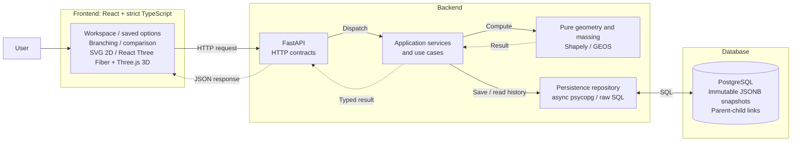
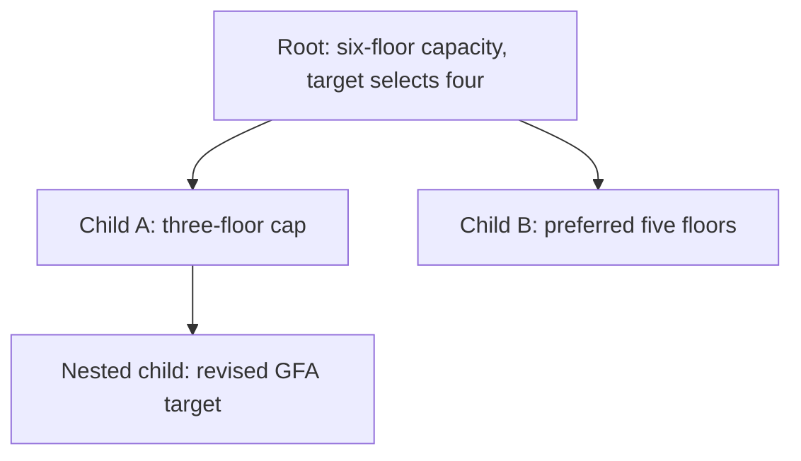

# Design note

## Problem interpretation and MVP scope

Early-stage massing turns a site boundary and planning constraints into a buildable
volume. The [assignment](../README.md) asks for that calculation, visualization and
persisted options that let an architect explore alternatives through a decision tree.
The schema, API, construction algorithm and rendering approach are design choices.

The delivered prototype supports one planar site and one connected building per
option. Users can draw a site; set setback, height, floor-count, coverage and footprint
limits; add floor/area preferences or a minimum GFA target; and preview the result.
They can save a root, branch alternatives, reopen history and compare saved results.
The backend owns geometry, metrics and feasibility; the frontend presents the same
result in an SVG plan and interactive 3D view. Delivering both views is a scope choice,
not an employer requirement.

The prototype models early-stage massing rather than architectural layouts or
regulatory compliance. Uniform repeated floor plates define GFA without circulation,
usable-area or facade deductions. Coordinates are local metres, not longitude/latitude.
Authentication, multi-user permissions, automatic suggestions, global optimization,
multiple buildings and production hosting are outside this delivery.

## Architecture and domain model

The scaffold's FastAPI, asynchronous psycopg pool, raw parameterized SQL,
PostgreSQL and Vite/React remain. Shapely/GEOS supplies topology and offsets;
React Three Fiber/Three.js supplies interactive 3D. There is no ORM or client-side
massing engine.

| Decision | Rationale | Trade-off |
| --- | --- | --- |
| Shapely/GEOS for geometry | Reuse established topology, polygon validation and offsets, including holes and concavity. | Floating-point and engine-version behavior still need explicit invariants and regression coverage. |
| One connected building | Largest-component selection gives each option an unambiguous footprint and floor stack. | Disconnected buildable land can remain unused. |
| Deterministic bounded construction | Fixed searches give repeatable candidates with bounded iterations. | Orientation and topology can cause undershoot; no optimality guarantee. |
| Immutable PostgreSQL JSONB snapshots | Reopen and compare complete historical calculations without recomputation. | Duplicate data and limited normalized analytics; historical schema changes need a migration policy. |
| SVG 2D plus interactive Three.js 3D | A plan exposes boundaries and dimensions; 3D explains floor stacking and height. | Two display pipelines need correspondence tests, complexity limits and WebGL fallbacks. |
| TanStack Query plus local React state | Keep remote snapshots in one cache and interaction state with its owning component. | Navigation and session boundaries need explicit coordination; drafts do not survive reload. |

`app.geometry` owns validation, canonicalization, setbacks and footprint construction.
`app.massing` owns floor limits, preferences, targets, feasibility and measured
results. Application use cases map domain results into transport-independent
snapshots; FastAPI owns Pydantic contracts and error translation. Repositories own
SQL and transactions. CPU-bound generation runs in worker threads; database I/O
uses the existing async pool. Preview computation itself performs no database work.

| Domain concept | Contract |
| --- | --- |
| Site | Valid, positive-area Polygon, optionally with holes; finite XY coordinates. |
| Hard constraints | Non-negative setback; positive floor spacing; height and/or floor cap; optional coverage and footprint caps. |
| Preferences | Optional exact positive floor count and desired positive footprint area, subordinate to hard limits. |
| Target | Optional non-negative minimum GFA, distinct from hard constraints. |
| Result | Complete setback context, hard bounds, demonstrated generated capacity, actual geometry/metrics, assessments and diagnostics. |
| Option | Immutable configuration/result snapshot with UUID, optional parent, versions and creation time. |

The domain calls its area limit `max_footprint_area_m2`; HTTP calls it
`max_footprint_m2`, with explicit mapping at the application boundary. Coverage is
footprint area divided by original site area; holes subtract from every measured
polygon area. Total buildable area includes all setback components, while selected
buildable area describes only the component used for the building.

Actual `height_m = floor_count * floor_to_floor_m` and
`gfa_m2 = footprint_area_m2 * floor_count`. One floor-plate Polygon plus count and
spacing represents repeated floors compactly; the backend does not serialize meshes.
A missing building has null actual geometry and metrics, never fabricated zero values.

### End-to-end example

A 40 × 25 m site with a 3 m setback leaves a 34 × 19 m footprint: 646 m².
At 3.5 m floor spacing, a 24 m height cap permits six floors; the explicit six-floor
cap leaves that maximum unchanged. A minimum GFA target of 2,000 m² selects four
floors: three provide 1,938 m², while four provide 2,584 m² at 14 m height.
The target is met; the hard and generated GFA capacities remain 3,876 m².

The user can inspect the same result in 2D/3D and save it as a root option. Changing
constraints or preferences in a branch draft produces a new child on save; the
parent's configuration and computed result remain unchanged.

## Geometry and feasibility approach

### Validation and setbacks

Site input must contain explicitly closed rings with at least three distinct points,
finite numeric XY positions, positive area and valid GEOS topology. Self-intersections,
degenerate rings, booleans, numeric strings and direct MultiPolygon sites are rejected.
Inputs are not snapped, repaired or silently closed. Canonicalization removes only
exact consecutive duplicates, normalizes ring starts/order and orients exterior rings
counter-clockwise and holes clockwise, without decimal rounding.

Shapely is pinned to 2.2.0. GEOS is bundled with wheels; source builds may link a
different version. Snapshot metadata records runtime engine versions because topology
and near-collapse behavior can vary between versions.

Positive setbacks use `site.buffer(-setback_m, join_style="mitre", mitre_limit=5)`.
Zero setback preserves the canonical input directly. Empty results remain empty;
split results preserve the complete Polygon/MultiPolygon and select its largest
positive-area Polygon. Ties use bounding box then canonical coordinates. This is a
single-building choice, with retained/discarded area and split diagnostics exposed.
Every returned setback must satisfy strict `site.covers(buildable)`.

### Area caps and bounded footprint construction

Let `N` be the maximum permitted floor count and `U` the footprint hard upper bound:

- `N` is the smaller supplied floor-count cap and height-derived count.
- `U` is the minimum of selected buildable area, original site area times any
  coverage cap, and any explicit maximum footprint area.
- `U * N` is the theoretical GFA upper bound under this model.

When the selected Polygon fits `U`, return it directly, preserving holes and vertices.
Otherwise search mitred inward buffers of the original selected component. A finite
bracket is expanded at most eight times, followed by at most 48 binary-search steps.
Retain the largest measured, valid, connected candidate at or below the cap.

A positive buffer result with material area undershoot enables an optional clipping
fallback. Four fixed directions retain lower/upper X or Y half-planes, bounded by
the selected component's extent. Each uses at most 48 intersections; midpoint
stagnation ends the search. Positive Polygon parts are selected deterministically;
GeometryCollection boundary lines/points do not become building geometry.
Clipping replaces buffering only for an area gain above the area comparison tolerance.
A satisfactory buffer result needs no clipping; if no positive buffer candidate is
found, the outcome remains `generation_failed`.

GEOS intersections on slanted boundaries can be valid yet fail exact containment
because of floating-point rounding. Such an optional clipping candidate is rejected
and its search direction ends; reliable prior candidates and the valid buffer result
remain available. Every returned footprint must still satisfy exact
`selected.covers(footprint)` and measured area at or below the hard cap. Invalid
constructed topology and unexpected GEOS errors remain internal errors, not ordinary
input rejection. No broad exception handler or geometry repair masks those failures.

The heuristic improves the supplied notched and dumbbell cases, but axis-aligned
clipping is orientation-dependent and may undershoot on connected multi-lobe sites.
Neither buffering nor clipping proves optimality or geometric impossibility.
`generated_footprint_area_m2 * N` is demonstrated generated capacity, separate from
`U * N`; actual preferences may produce a third, different result. Construction
component counts and undershoot remain domain metadata, not new API metrics.

### Floors, preferences and targets

Height capacity uses the exact rational quotient of stored binary64 height and floor
spacing, then floors it. No epsilon admits an over-height floor; floor-count integers
never pass through float. For example, stored `36.0` and `3.6` permit nine floors:
ten exact copies of the stored spacing exceed the stored height. This numerical
policy is an implementation choice; exact decimal semantics would need a new contract.

A preferred floor count above `N` is a validation error. Preferred area searches for
`min(requested, U)` using the same construction. Its assessment preserves requested,
effective and actual area, signed difference and any approximation/clamping diagnostic.
Failure to construct the preferred area does not silently substitute the default.

Without an explicit floor preference, an absent/zero target uses `N`; a positive
target selects the minimum permitted count meeting it on the measured actual
footprint. An explicit floor preference remains unchanged when it misses a target.
The same target predicate governs floor selection and final assessment.

| Feasibility status | Meaning | Hard constraints satisfied |
| --- | --- | --- |
| `feasible` | Positive valid building; target met or absent. | `true` |
| `feasible_target_unmet` | Positive valid building; desired GFA missed. | `true` |
| `infeasible` | Empty setback region or zero permitted floors. | `false` |
| `generation_failed` | Construction found no valid positive footprint; impossibility unproven. | `null` |

Empty buildable geometry takes precedence over zero permitted floors. Both skip
construction and retain useful context. Supplied targets without a building are
`not_evaluated`; absent targets are `not_requested`.

An unmet target is classified, in order, as `TARGET_EXCEEDS_UPPER_BOUND`,
`TARGET_BEYOND_GENERATED_CAPACITY`, or `TARGET_UNMET_WITH_PREFERENCES`.
The second case explicitly leaves room for another construction to succeed.
Unknown generated capacity remains null; it is not treated as zero or hard infeasibility.

### Numerical policy

Area comparison tolerance is `max(1e-8, 1e-9 * max(site_area_m2, 1))` square metres.
It governs material improvements and preference comparisons, not positive-area
filtering, strict containment or permission to exceed area caps. GFA tolerance
propagates area tolerance through floor capacity and is conservatively capped at
`1e-9 * comparison_scale_m2`, so large counts cannot hide material shortfalls.

Required metrics must remain finite reportable numbers. Exact stored-float-by-integer
multiplication preserves large floor counts until conversion; unrepresentable metrics
or positive coverage underflow produce `NUMERICAL_RANGE_ERROR`, not infeasibility.
Only NumPy floating-point overflow/invalid arithmetic in the shared inward-buffer
call becomes an invalid-site error. Unexpected GEOS exceptions still propagate.
Near-collapse GEOS output may differ from ideal mathematical erosion; valid tiny
components are retained without a minimum-area cutoff or custom repair.

## Persistence and decision-tree relationships

### Stored versus derived

Saving recomputes on the server and stores the canonical site, complete constraints,
preferences, targets and complete result as JSONB. Results are derived during saving,
then historical facts during reading: reopening or comparing never reruns generation.
Self-contained snapshots favor simple reliable reads over normalized analytics.
Schema version 1 and algorithm policy `massing-v3` plus Shapely/GEOS versions identify
interpretation. Older `massing-v1`/`massing-v2` snapshots remain readable unchanged;
new branches record the current algorithm.

The `options` table contains UUID identity, nullable parent foreign key/name,
configuration/result JSONB, versions, indexed feasibility status and creation time.
A check keeps the indexed status consistent with the result. Parent deletion is
restricted; indexes support parent lookup and creation-time/UUID listing.
The public API has no update or delete operation. Immutability is enforced through
application writes, not database permissions against arbitrary direct SQL.

A branch inherits the saved parent's site and replaces its complete constraints,
preferences and targets. Omitted preferences/targets use empty defaults rather than
merging parent values. Each save inserts a new UUID; parents, siblings and ancestors
remain unchanged. Parent lookup and insertion do not hold a transaction across CPU
work; the immutable API and foreign key protect supported operations.

Each node is a separate stored snapshot; arrows are parent links, not updates.
Creating the nested child leaves its ancestors and sibling branch unchanged.

Tree retrieval uses one recursive SQL query for summary metadata and metrics, then
assembles nested children ordered by ascending `(created_at, id)`. Any child may be
the selected subtree root, retaining its stored parent ID. Ancestors, siblings and
unrelated roots are excluded. Supported insert-only parent links cannot form cycles.
Summary listing uses newest-first `(created_at, id)` with limit/offset pagination.

Comparison reads exactly two distinct saved IDs in request order, including unrelated
roots. Complete snapshots accompany explicit input, metric, feasibility, target and
diagnostic pairs. Changed flags use exact stored equality; numeric differences are
right minus left, or null if either value is missing. Site comparison is structural
JSON equality, not geometric equivalence. Comparisons make no writes.

Numbered SQL migrations run explicitly before server workers start. A transaction
advisory lock serializes migration execution; SHA-256 checksums verify applied history.
Pending files and ledger entries commit atomically. Applied migrations are immutable.
The Compose database uses a named persistent volume; application restarts retain it.

## API contract

All paths below are relative to `/api/v1`. `/docs` and `/openapi.json` provide the
complete typed contracts and executable preview example.

| Method and path | Behavior |
| --- | --- |
| `GET /health` | Process health response; not a database-readiness probe. |
| `POST /massing/preview` | Validate and compute configuration; `200` for all domain statuses. |
| `POST /options` | Recompute and insert immutable root; `201` with `Location`. |
| `POST /options/{id}/branches` | Inherit parent site, recompute replacement configuration; `201`. |
| `GET /options` | Summary array; default limit 50, maximum 200, offset default 0. |
| `GET /options/{id}` | Complete saved snapshot without recomputation. |
| `GET /options/tree?root_id={uuid}` | Selected summary and recursive `children`; leaves use `[]`. |
| `POST /options/compare` | Exactly two distinct ordered `option_ids`; snapshots and comparison. |

Preview/root bodies require `site` and `hard_constraints`; branch bodies require
`hard_constraints` and forbid site/parent/result fields. Preferences and targets
default to empty objects; null objects and unknown fields are invalid. Optional scalar
fields may be null. Save names are optional, trimmed, 1–200 characters when supplied,
and cannot contain NUL. Repeated saves intentionally create separate options.

Responses distinguish original site, complete buildable region, selected component,
generated default footprint, actual footprint and repeated floor plate. Metrics keep
hard upper bounds, generated capacity and actual results separate. Setback summaries,
preference assessments, feasibility and structured diagnostics accompany geometry.
All four domain statuses can be saved, including null-building diagnostic snapshots.

Errors use `{error: {code, message, details: [{path, message}]}}` without submitted
values or exception contexts. Invalid geometry, constraints, preferences, targets,
excessive floor preferences and numerical range use section-specific `422` codes;
malformed requests use `INVALID_REQUEST`. Missing saved IDs use `404 OPTION_NOT_FOUND`;
missing branch parents use `PARENT_OPTION_NOT_FOUND`. Comparison validation uses
`INVALID_COMPARISON`. Internal geometry failures are not mislabeled as validation.

## 2D/3D frontend architecture

TanStack Query owns remote previews and immutable snapshots; React Hook Form + Zod
owns configuration drafts. Local React state owns navigation, selections and display
controls. No Zustand store or duplicate result model is needed. Preview is explicit;
draft edits update only the separate site outline. Pending/failed preview attempts
remove stale successful results. Saving recomputes rather than trusting a preview.

The Workspace, Saved Options and Compare sections preserve their interaction state
while hidden. Opening a saved option retrieves its exact UUID before replacing work;
unsaved/invalid drafts, previews, name drafts and pending saves require explicit
replacement. A branch starts a distinct draft with inherited read-only site and needs
a fresh preview. Query keys and session identity isolate cancellation and late responses.
Save retries are disabled because automatic replay could create duplicate snapshots;
a lost success response remains uncertain until saved history is inspected.

The SVG plan renders original site, complete setback, selected component and actual
footprint from one backend result. Even-odd paths preserve holes and all MultiPolygon
components. Shared original-site framing keeps layers comparable. Optional dimensions
measure original coordinates; they never change geometry, metrics or requests.

SVG display supports at most 10,000 coordinate positions across the rendered layers,
including holes, components, repeated ring closures and coincident layers. Budget
checks precede path construction and annotation work.
A separate 250-edge measurement budget bounds dimension layout while preserving the
plan. These are conservative renderer limits, not backend input or feasibility limits;
no geometry is truncated, simplified or omitted to fit. Unsupported display shows an
accessible explanation while metrics, diagnostics, save, branch and compare remain usable.
Draft outlines and drawing display paths apply the same guard before expensive SVG
work. Drawing counts its point markers and reserves the two-position cursor segment,
so about 5,000 exterior points exhaust its budget before a plain outline would.

The lazy-loaded 3D viewer uses the same actual footprint, floor plate, count, spacing
and height. Backend XY maps to Three.js XZ with Y up; centering and uniform scaling
preserve proportions while improving Float32 precision. Three.js triangulates holes;
one instanced extrusion represents repeated floors. Orbit, zoom and reset-to-fit are
display controls only. Missing buildings retain available site/setback context.

3D limits are 512 floors, 20,000 ring vertices across supplied layers (excluding
closing duplicates), and 500,000 extruded triangles across floor instances. Precision,
structural and height-consistency guards reject unsupported display without altering
results. WebGL2 failure/context loss and renderer errors show an explicit fallback;
SVG fallback still obeys its own budget. View/option changes dispose previous renderer
resources; comparison mounts one selected saved option at a time and makes no
preview/save request when switching representations.

## Testing and numerical correctness

Backend tests cover fixture and analytical cases, holes, concavity, split/empty
setbacks, invalid topology, strict containment, strict caps, deterministic selection,
serialization, exact floor limits and target/preference outcomes. Slanted concave
public-preview regressions and a small seeded collection guard clipping numerics.
Independent contained witnesses protect notched/dumbbell improvements; a multi-lobe
counterexample preserves the distinction between heuristic capacity and hard bounds.
Unexpected-error and genuinely out-of-bounds cases protect the invariant boundary.

PostgreSQL integration tests create isolated disposable databases. They cover locked
migrations, immutable saves/branches, ordering, null statuses, unchanged parents,
subtree retrieval and read-only comparison. They skip without `TEST_DATABASE_URL`;
a configured unreachable server fails. Browser reload never substitutes for DB evidence.

Frontend verification covers strict types, lint, complete Vitest suite, production
and renderer-harness builds, form/state races, saved workflows, geometry layers,
holes, budget boundaries, dimension guards and safe fallback. Real-browser checks
establish 2D/3D interaction and WebGL cleanup; jsdom cannot establish GPU behavior.
Compose smoke checks cover packaging, startup/migrations, HTTP routes, persistence,
branching, comparison and restart survival. Exact commands/results belong in the
review report rather than a permanent assertion that every future build passes.

## Assumptions, trade-offs and known limitations

- Largest-component selection and fixed bounded searches favor predictable behavior
  over optimal site utilization. Heuristic undershoot is not proof of infeasibility.
- Binary64 geometry has scale/near-collapse limitations; valid backend geometry may
  exceed SVG/WebGL budgets or display precision. Backend results remain authoritative.
- Repeated plates omit setbacks varying by storey, podiums, circulation and code rules.
- JSONB snapshots duplicate data and have no historical schema migration tooling.
- Two Uvicorn workers and per-worker pools are suitable for this demo; generation is
  bounded per search but concurrency/admission limits are not production controls.
- Whole-subtree reads, recursive serialization and offset pagination target small
  histories. Extreme decision-tree depth/size and concurrent inserts need bounded
  traversal, pagination and measured limits before wider use.
- Saves have no idempotency key. Authentication, authorization, shared editing and
  production secrets/deployment hardening are outside this local prototype.
- Docker retains Python 3.12, Node 20 and PostgreSQL 16 base lines. Lockfiles plus
  pinned uv and `npm ci` improve dependency reproduction; base tags are not digest-pinned.

## Prioritized roadmap

These are proposed product extensions, not delivered features or additional employer
requirements. The order improves local exploration first; shared deployment requires
the safeguards in priority 6 regardless of feature progress.

1. **Option management:** add renaming, archiving and explicit option/subtree deletion.
   Define editable presentation metadata separately from calculation history; make
   deletion scope visible, confirm destructive actions and preserve referential integrity.
2. **Versioned editing:** reopen a saved configuration for revision and save a new
   version or branch with explicit lineage. Extend the existing branch workflow;
   never overwrite historical geometry, configuration or computed results.
3. **Geometry optimization:** benchmark challenging concave and multi-lobed sites
   against independently known attainable footprints, then evaluate better construction
   strategies. Keep demonstrated capacity distinct from theoretical hard limits.
4. **Performance and scalability:** profile large polygons and histories, then add
   bounded tree navigation, pagination and resource limits. Introduce background
   processing only when measured request times or concurrency justify it.
5. **Richer massing models:** define contracts for site-specific zoning, multiple
   building volumes and more realistic constraints before extending floor stacks
   or allocating disconnected components.
6. **Collaboration and production readiness:** add authentication, authorization,
   auditability, idempotent saves and operational safeguards before shared deployment.
   Establish tenant boundaries, deployment security and recovery procedures first.
