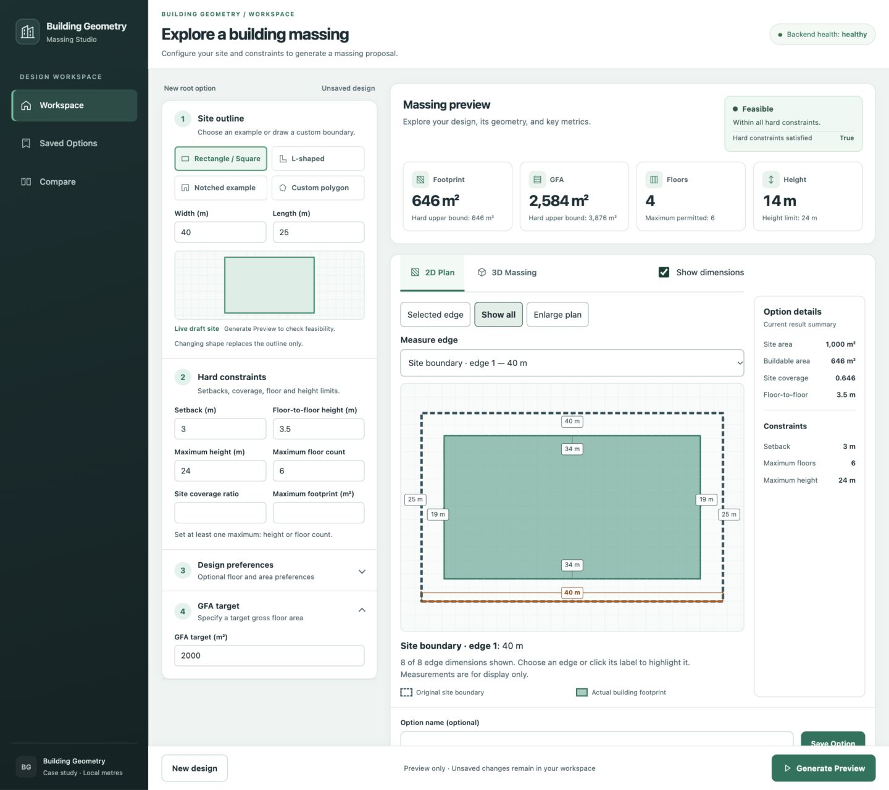
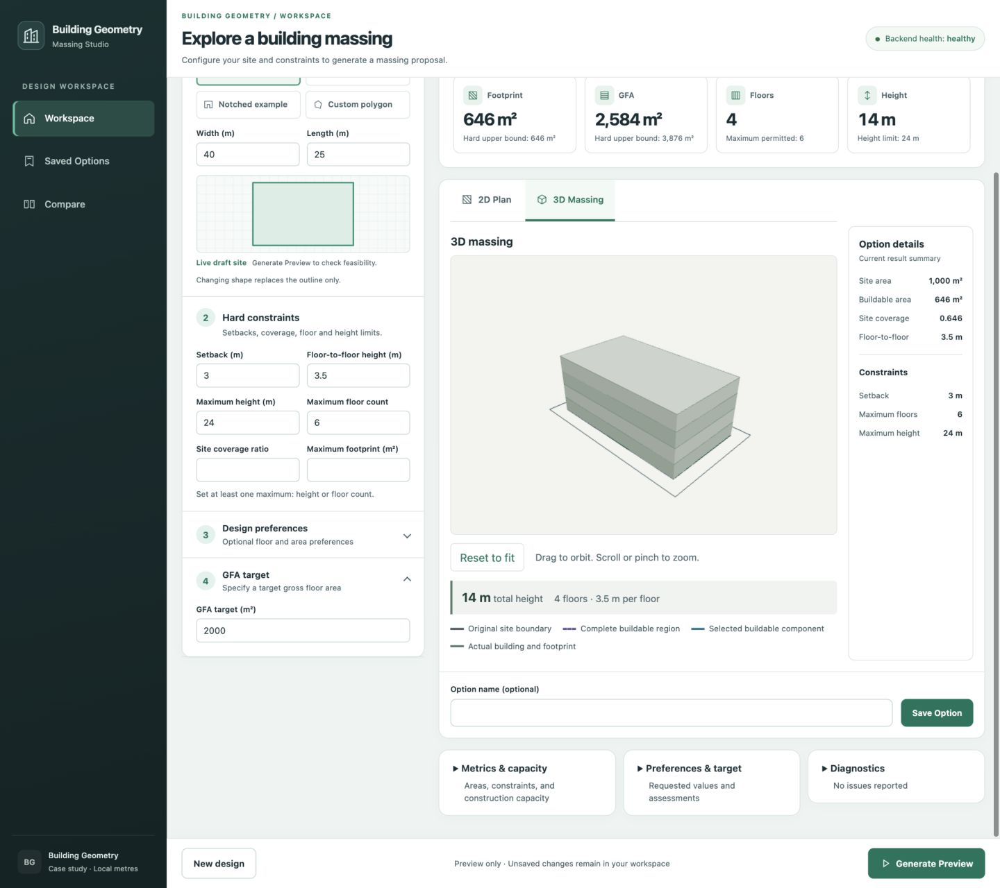
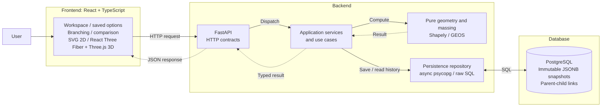

# Building Geometry Case Study — Design Note

This prototype lets architects draw
a site, apply planning constraints, inspect a generated building in 2D and 3D, and save, branch and compare design
options.

**Try it locally:** `docker compose up --build` → <http://localhost:5173>. **API reference:** [FastAPI OpenAPI](http://localhost:8000/docs) · **Setup:**
[Frontend README](../frontend/README.md).

**Live demo:** [Building Geometry Explorer](https://building-geometry-demo.onrender.com/)

Three decisions shape the system:

- **One source of truth.** FastAPI and Shapely own geometry, numerical metrics and feasibility. SVG and Three.js render
  the same server-produced result.
- **History is immutable.** PostgreSQL stores complete JSONB snapshots. Branching creates a child rather than editing a
  previous decision.
- **Failure is explicit.** Deterministic, bounded construction returns a measured result without claiming global
  optimality. Failed search differs from proven hard infeasibility.



*Figure 1. Hosted 2D preview of the 40 × 25 m example: 3 m setback, 646 m² footprint, four floors and 2,584 m² GFA. Setback, selected region and footprint coincide in this case.*

## Product walkthrough and scope

The core workflow is **site → constraints → preview → save → branch → tree → compare**. Choose the rectangle, L-shaped
or notched preset, or draw a custom exterior boundary. Advanced GeoJSON input also supports polygon holes. Configuration
changes remain drafts until another preview is requested. Save a root, branch a revised configuration, then use the
saved tree to reopen or compare alternatives without recalculating their historical results.

| Included | Outside the current scope |
| --- | --- |
| One planar Polygon site, optional holes, local metre coordinates | Geographic coordinates and surveying transformations |
| One connected building per option | Multiple buildings or independent floor stacks |
| Setback, height, floors, coverage, footprint caps, preferences, minimum GFA target | Detailed zoning, code compliance and room layouts |
| SVG plan, interactive 3D, metrics and diagnostics | Photorealistic modeling or architectural editing |
| Immutable saves, branches, tree navigation and two-option comparison | Authentication, shared editing, automatic suggestions and global optimization |

### A reproducible example

A 40 × 25 m site has area 1,000 m². A 3 m setback leaves a 34 × 19 m footprint: 646 m². With 3.5 m floor-to-floor
spacing, a 24 m height cap and a six-floor limit permit at most six floors.

For a minimum GFA target of 2,000 m², the algorithm chooses the smallest sufficient floor count: three floors yield
1,938 m², while four yield 2,584 m² at 14 m height. Both the theoretical upper GFA bound and the demonstrated capacity
of the generated footprint are 3,876 m² in this case. The [preview request below](#example-target-driven-preview) reproduces the calculation.



*Figure 2. The same hosted preview in real WebGL2: four repeated 3.5 m floors, 14 m total height. Orbit and reset-to-fit were exercised.*

## Why SVG and interactive 3D?

SVG is the primary inspection view. It exposes the relationship between the site boundary, setbacks, selected component,
footprint and holes. For this small set of vector paths, SVG supports direct inspection and accessible descriptions
without custom Canvas redraw and hit-testing logic.

3D shows how that footprint becomes a volume through floor stacking and height. React Three Fiber integrates Three.js
with React's component lifecycle and saved-option selection, keeping scene synchronization within the existing UI
architecture.

| Alternative | Trade-off for this prototype |
| --- | --- |
| SVG only | Precise plan inspection, but less direct communication of height and volume. |
| Canvas 2D | A candidate for dense scenes, with additional redraw, hit-testing and accessibility work. |
| Raw Three.js | Low-level control, with an additional imperative scene-synchronization and cleanup layer. |

Two rendering pipelines add a lazy-loaded 3D bundle, triangulation and camera handling, GPU-resource cleanup, WebGL2
fallbacks and fixture-based correspondence tests. Both consume one backend result. A 2D-only solution would be
appropriate when browser coverage, accessibility or measured performance makes WebGL2 unsuitable; the domain and API
would remain usable with the SVG plan and metrics.

## Architecture and domain boundaries

The FastAPI, async psycopg pool, raw parameterized SQL, PostgreSQL and Vite/React stack is retained. The Python domain
is independent of transport and persistence. There is no ORM or browser-side massing engine.



`app.geometry` owns validation, canonicalization, setbacks and footprint construction. `app.massing` owns floor
limits, preferences, targets, feasibility and measured results. Application services orchestrate computation and
snapshot creation. HTTP schemas own the external contract, while repositories own parameterized SQL and transactions.
CPU-bound computation runs outside the async event loop. Preview performs no PostgreSQL reads or writes.

| Concept | Contract and responsibility |
| --- | --- |
| Site | Valid, positive-area GeoJSON-style Polygon with finite XY coordinates and optional holes. |
| Hard constraints | Non-negative `setback_m`, positive `floor_to_floor_m`, at least one of `max_height_m` or `max_floors`, optional coverage/footprint caps. |
| Preferences | Optional exact positive floor count and desired positive footprint area, subordinate to hard limits. |
| Target | Optional non-negative minimum `gfa_target_m2`; missing it does not automatically invalidate a building. |
| Massing result | Site/buildable/selected geometry, hard bounds, generated capacity, actual geometry and metrics, feasibility and diagnostics. |
| Option | UUID, optional parent/name, configuration, result, schema/algorithm metadata and creation timestamp. |

The HTTP footprint cap is `max_footprint_m2`, mapped to `max_footprint_area_m2` in the domain.

### Correctness invariants

- Every successful footprint is a valid, positive-area Polygon, exactly covered by the selected buildable component and
  within every supplied area cap. Boundary contact is permitted by `covers`.
- Area subtracts holes. Total buildable area includes all setback components; selected area measures the component
  chosen for one building. Coverage divides actual footprint area by original site area.
- `height_m = floor_count * floor_to_floor_m` and `gfa_m2 = footprint_area_m2 * floor_count`. One floor-plate Polygon represents repeated floors; the API does not
  serialize meshes.
- Hard upper bound, demonstrated generated capacity and actual selected result describe different quantities. An area
  bound does not prove a footprint can be constructed at that exact area.
- With no valid building, actual geometry, floor count, height and GFA are `null`. Available site metrics
  and limits remain present.

## Geometry algorithm and feasibility

### Input validation and setbacks

Shapely/GEOS supplies polygon validity, offsets, holes and concavity, avoiding a custom topology implementation.
Clipper2 would introduce integer scaling and binding choices; using PostGIS would couple preview computation to database
infrastructure. These remain alternatives if the operating requirements change.

Rings must be explicitly closed, contain at least three distinct vertices and form a positive-area valid Polygon.
Self-intersections, degeneracy, numeric strings, booleans and direct MultiPolygon sites are rejected. Canonicalization
normalizes orientation, ring order and exact duplicate neighbours without repair or rounding.

Positive setbacks use `site.buffer(-setback_m, join_style="mitre", mitre_limit=5)`. Zero setback preserves the canonical site. Split results retain the complete
Polygon/MultiPolygon for display, while construction selects its largest positive component with deterministic
tie-breaking. Exact `site.covers(buildable)` and `selected.covers(footprint)` checks protect containment.

### Hard bounds and constructive search

Let `N` be the minimum of the supplied floor cap and height-derived floor count when both apply. Let
`U` be the minimum of selected buildable area, original site area times the optional coverage cap, and
the optional footprint cap. Then `U * N` is the theoretical GFA upper bound for this single-building,
repeated-plate model.

If the selected component fits under `U`, use it directly. Otherwise, bounded inward-buffer search
retains a valid, connected candidate within the cap. Only a positive buffer result with material undershoot enables
optional axis-aligned half-plane clipping in four directions. Clipping replaces the buffer result only for a material
area gain. Every returned candidate must satisfy validity, exact containment and the hard cap. The search is
deterministic and bounded, with no global optimality guarantee.

`generated_footprint_area_m2 * N` is the default footprint's demonstrated capacity. Preferences can select a different actual footprint
or floor count. Failure to construct a positive footprint while buildable area and floor allowance remain positive
returns `generation_failed`; it does not prove geometric impossibility.

Floor preferences are exact choices. After empty-region and zero-floor checks, a preferred count above
`N` returns `422 PREFERENCE_EXCEEDS_HARD_LIMIT`. Area preferences search toward `min(requested, U)` and expose requested,
effective and actual values, including approximation or clamping. Failed preferred-area construction never silently
substitutes the default footprint. Without a floor preference, a positive GFA target selects the smallest sufficient
floor count on the measured actual footprint, bounded by `N`. If no permitted count meets the target, it uses `N`
and reports the shortfall. An absent or zero target also uses `N`.

### Four distinct result states

| Status | Meaning | Hard constraints satisfied? |
| --- | --- | --- |
| `feasible` | A valid positive building exists; target met or absent. | `true` |
| `feasible_target_unmet` | A valid building exists, but GFA is below target. | `true` |
| `infeasible` | Setback leaves no positive buildable region, or limits permit zero floors. | `false` |
| `generation_failed` | Search found no valid positive footprint; impossibility remains unproven. | `null` |

Missed targets are classified as `TARGET_EXCEEDS_UPPER_BOUND`, `TARGET_BEYOND_GENERATED_CAPACITY`, then
`TARGET_UNMET_WITH_PREFERENCES`, in that order. Capacity-dependent diagnoses are withheld when generated capacity is
unknown, so an unmet target within the hard bound can have a null diagnostic code. An absent target is `not_requested`;
a target without a building is `not_evaluated`. All four domain states return
preview HTTP 200 and can be saved as diagnostic snapshots. Invalid input returns HTTP 422.

Numerical comparisons never relax containment or area caps. Height-derived floors use the exact quotient of stored
binary64 operands without a positive epsilon. Required metrics must be finite; unrepresentable results raise
`NUMERICAL_RANGE_ERROR`. [Footprint construction](../backend/app/geometry/footprints.py), [floor limits](../backend/app/massing/floors.py) and their regression tests preserve these distinctions.
Detailed budgets and tolerances appear in the appendix.

## Persistence and option history

Saving recomputes from submitted inputs, then inserts the canonical configuration, computed result, diagnostics and
version metadata. Reopening and comparing retrieve stored results without rerunning geometry. Self-contained JSONB
snapshots simplify historical reads at the cost of duplication and limited normalized analytics.

| `options` field group | Stored content |
| --- | --- |
| Identity | `id` (UUID), nullable `parent_id`, optional `name`, `created_at` |
| Versioning | `schema_version`, `algorithm_version` including runtime Shapely/GEOS versions |
| Configuration | `site_geometry`, `hard_constraints`, `preferences`, `targets` (JSONB) |
| Outcome | `result` (JSONB), `feasibility_status` checked against the result |
| Access paths | Indexes on `parent_id` and `(created_at, id)`; no dedicated feasibility-status index |

The Docker entrypoint applies numbered SQL migrations before starting Uvicorn workers. Direct local startup requires
`uv run app migrate`. A PostgreSQL advisory lock and transaction serialize migration history checks and pending changes.
SHA-256 checksums detect edits to applied files. The schema and queries live in
[the initial migration](../backend/app/sql/migrations/001_create_options.sql) and [option repository](../backend/app/persistence/options.py).

A branch inherits its parent's site and replaces the complete constraints, preferences and targets configuration.
Omitted preferences/targets become empty defaults. Every save creates a new UUID, leaving parents and siblings
unchanged. A recursive SQL query loads a selected subtree, with children ordered by `(created_at, id)`. Comparison reads
exactly two distinct snapshots in request order. Numeric differences are right minus left, or `null` if
either is unavailable.


*Figure 3. Composite of two real hosted views: a saved six-floor root and its three-floor child, then their stored
comparison. The six-floor root is a separate saved configuration without a GFA target. Figures 1 and 2 show the
four-floor GFA-target preview. The footprint remains 646 m²; height changes from 21 to 10.5 m and GFA from 3,876 to 1,938 m².*

Schema version 1 and current `massing-v3` policy plus Shapely/GEOS versions record calculation provenance. They do
not implement a general historical schema migration or version-dispatch layer. The public API has no update/delete
route; immutability depends on supported application writes, not restrictions on arbitrary direct SQL.

## API contract

All routes below are relative to `/api/v1`. OpenAPI contains complete typed schemas and executable examples.

| Method | Route | Purpose |
| --- | --- | --- |
| GET | `/health` | Process health, not database readiness |
| POST | `/massing/preview` | Validate and calculate a transient result |
| POST | `/options` | Recompute and save a root (`201`, `Location`) |
| POST | `/options/{id}/branches` | Inherit site; recompute and save a child (`201`) |
| GET | `/options` | Newest-first summaries; limit default 50/max 200, offset default 0 |
| GET | `/options/{id}` | Retrieve an immutable snapshot |
| GET | `/options/tree?root_id={uuid}` | Retrieve a selected subtree |
| POST | `/options/compare` | Compare two distinct ordered `option_ids` |

### Example: target-driven preview

Request — `POST /api/v1/massing/preview`:

```json
{
  "site": {
    "type": "Polygon",
    "coordinates": [[[0, 0], [40, 0], [40, 25], [0, 25], [0, 0]]]
  },
  "hard_constraints": {
    "setback_m": 3,
    "floor_to_floor_m": 3.5,
    "max_height_m": 24,
    "max_floors": 6
  },
  "targets": { "gfa_target_m2": 2000 }
}
```

Response — HTTP 200, **selected fields only**:

```json
{
  "metrics": {
    "site_area_m2": 1000,
    "footprint_area_m2": 646,
    "floor_count": 4,
    "height_m": 14,
    "gfa_m2": 2584,
    "gfa_upper_bound_m2": 3876,
    "generated_gfa_capacity_m2": 3876
  },
  "feasibility": {
    "status": "feasible",
    "hard_constraints_satisfied": true,
    "target_assessment": {
      "requested_m2": 2000,
      "actual_m2": 2584,
      "shortfall_m2": null,
      "status": "met",
      "diagnostic_code": null
    }
  }
}
```

The full response includes normalized configuration, the original site, buildable region, selected component,
generated and actual footprints, repeated floor plate, setback metadata, preferences and diagnostics.
The [backend README](../backend/README.md) includes this preview example and setup.

Validation errors use `{ "error": { "code": "...", "message": "...", "details": [{ "path": "...", "message": "..." }] } }`. Invalid domain inputs and numerical range return section-specific 422 codes;
malformed requests use `INVALID_REQUEST`. Unknown options return `404 OPTION_NOT_FOUND`; absent branch parents use
`PARENT_OPTION_NOT_FOUND`; invalid comparisons use `INVALID_COMPARISON`. Validation avoids echoing submitted payloads, but GEOS
topology messages can contain coordinates. Unhandled internal failures remain outside this structured error contract.

## Frontend state and rendering

| Concern | Owner | Reason |
| --- | --- | --- |
| Form values, validation and dirty state | React Hook Form + Zod | Drafts remain separate from saved snapshots |
| Preview/options/cache lifecycle | TanStack Query | Central server-state cache and request identity |
| Active section, tree selection, display controls | Local React state | No global store needed for this UI |
| Geometry, area, height, floors, GFA, feasibility | Backend | 2D/3D represent one authoritative result |

Draft edits retain the last submitted view with a stale-draft notice. Pending or failed replacement previews clear stale
successful views. Saves recompute and do not automatically retry because replay can create duplicate options. Opening a
saved snapshot protects unsaved work with an explicit replacement step. Branching starts a new draft with an inherited
read-only site.

SVG draws the site, all setback components, selected area, actual footprint and holes under one aspect-preserving frame.
Three.js uses the same backend floor plate, count, spacing and height with an instanced extrusion, orbit controls and
reset-to-fit. Display coordinate conversion does not change authoritative geometry. Complexity, precision and
consistency guards reject unsupported display without changing domain feasibility. WebGL2 failure offers SVG where that
geometry meets SVG limits; metrics and history remain available. See [renderer correspondence tests](../frontend/src/features/visualization/MassingVisualization.renderer.test.tsx) and [frontend smoke steps](../frontend/README.md#quick-manual-smoke-test).

## Edge-case behavior

| Case | Expected behavior | Result / evidence |
| --- | --- | --- |
| Concave or L-shaped site | Preserve concavity and exact containment. | Geometry regressions |
| Split setback | Preserve full MultiPolygon; select largest component and report discarded area. | `BUILDABLE_REGION_SPLIT` |
| Setback collapses region | Keep context, with no invented building. | `infeasible`, `EMPTY_BUILDABLE_REGION` |
| Height permits zero floors | Never construct an over-height floor. | `infeasible`, `ZERO_PERMITTED_FLOORS` |
| Self-intersecting/degenerate site | Reject invalid topology without repair. | `422 INVALID_SITE_GEOMETRY` |
| Preferred floors exceed viable hard cap | Reject the discrete preference after hard-infeasibility checks. | `422 PREFERENCE_EXCEEDS_HARD_LIMIT` |
| Requested area exceeds cap | Disclose clamping and actual area. | `PREFERENCE_CLAMPED_TO_HARD_CAP` |
| Target exceeds upper bound | Retain a valid building when available, with unmet target. | `feasible_target_unmet`, `TARGET_EXCEEDS_UPPER_BOUND` |
| Target exceeds generated capacity but not hard bound | Leave room for a better construction. | `TARGET_BEYOND_GENERATED_CAPACITY` |
| Positive region but no footprint constructed | Keep unknown generated capacity `null`. | `generation_failed`, `FOOTPRINT_NOT_GENERATED` |
| Display exceeds budget / WebGL2 unavailable | Show a bounded fallback or accessible explanation; retain backend result. | Frontend renderer tests |

## Verification

[CI run 41404253802](https://github.com/Aleks2580/building-geometry-case-study/actions/runs/41404253802) on [commit `0dac0fc`](https://github.com/Aleks2580/building-geometry-case-study/commit/0dac0fc1ea0b5c2e25485e502d221ea0e1238b0c) (2 November 2026) completed four successful jobs:

| Job | Executed checks and result |
| --- | --- |
| `lint` | `uv run ruff format --check .`, `uv run ruff check .`, `uv run pyright` succeeded |
| `test` | `uv run pytest --cov=app --cov-report=term-missing` with PostgreSQL: 692 passed; reported total coverage 91% |
| `frontend` | `npm ci`, both typechecks, lint, tests and both builds succeeded; 1,009 tests across 49 files |
| `docker-smoke` | Compose startup, HTTP health, rectangular/concave preview, save, branch, retrieval, tree and comparison succeeded |

These results describe the linked revision. The documentation changes were also checked locally on 3 November 2026:

| Local check | Result |
| --- | --- |
| Backend: `env -u TEST_DATABASE_URL PYTHONDONTWRITEBYTECODE=1 .venv/bin/pytest -p no:cacheprovider` | 597 passed, 95 database tests skipped; no database created or migrated |
| Backend: `.venv/bin/ruff check .`, `.venv/bin/ruff format --check .`, `.venv/bin/pyright` | Passed; 65 files formatted, zero type errors |
| Frontend: `npm run typecheck`, `npm run typecheck:renderer-test`, `npm run lint`, `npm run test` | Passed; 1,009 tests across 49 files |
| Frontend: `npm run build`, `npm run build:renderer-test` | Passed; Vite reported large-chunk warnings |

Commands ran from their respective app directories using existing dependencies. Local coverage was not collected.
The standalone harness build does not establish browser execution of its full resource/context-loss checks.

In a clean unauthenticated browser, the hosted preview API and SVG/WebGL2 views matched the JSON example.
Orbit and reset-to-fit worked with the four-floor result. The screenshots capture actual application views.
Saved root/child navigation, comparison and reopening after browser reload were exercised separately. The original
root's complete API snapshot was identical before and after branching.

CI's Compose smoke covers persisted HTTP workflows. It does not prove real GPU rendering or survival across an
explicit database restart. Local Compose startup, database integration tests and a database restart were not run.
[Frontend smoke steps](../frontend/README.md#quick-manual-smoke-test) describe broader manual checks.

## Assumptions, trade-offs and limitations

- One building with repeated plates supports early massing, omitting storey-specific setbacks, podiums, circulation,
  usable-area deductions and code compliance.
- Deterministic construction respects hard constraints for returned geometry but can leave usable area unfilled on
  complex multi-lobed sites.
- Floating-point geometry and GEOS versions can affect near-collapse behavior. Exact invariants and regressions reduce
  risk without eliminating numerical limits.
- A valid backend result can exceed display budgets or precision. Display failure does not change feasibility.
- JSONB snapshots duplicate data and have no automated historical schema migration. Whole-subtree reads and offset
  pagination target small histories.
- The demo has no save idempotency key, authentication, multi-user authorization, production concurrency limits or
  uptime guarantees. Public reachability does not establish production readiness.

## Prioritized roadmap

1. **Option management and version-aware diffs.** Add renaming, archiving and explicit revisions while preserving
   historical calculations. Compare successive versions field by field with version interpretation, extending the
   existing two-snapshot comparison. This first improves the daily exploration workflow.
2. **Geometry quality and GFA/footprint optimization.** Benchmark concave and multi-lobed sites against independently
   attainable footprints, then evaluate stronger construction and optimization strategies with explicit objectives.
   Improve utilization before multiplying building-model complexity.
3. **Performance from measurements.** Profile large polygons, deep trees and rendering. Add bounded traversal,
   pagination, resource limits or background processing where measured request times and concurrency justify them.
4. **Richer planning models.** Define site-specific zoning, varying floor plates and multiple buildings once the
   one-building contracts are stable, including explicit allocation rules for disconnected regions.
5. **Collaboration and deployment hardening.** Add authentication, authorization, tenant isolation, idempotent writes,
   auditing, rate limits and recovery procedures before shared editing. These safeguards gate multi-user deployment
   regardless of feature order.

SVG 2D and interactive Three.js 3D are already implemented. Visualization follow-up should address observed usability,
accessibility and performance issues.

## Implementation appendix

| Area | Current policy |
| --- | --- |
| Geometry engine | Shapely 2.2.0; runtime GEOS version recorded in option metadata |
| Buffer search | At most 8 bracket expansions and 48 binary-search steps |
| Optional clipping | Four axis-aligned directions, up to 48 intersections each; material gain required over a positive buffer result |
| Area comparison | `max(1e-8, 1e-9 * max(site_area_m2, 1))` m²; no relaxation of caps or containment |
| Height-derived floors | Floor the exact stored-binary64 quotient; no epsilon admits another floor |
| SVG renderer | 10,000 rendered positions across layers; 250 combined site/footprint edges for dimensions |
| 3D renderer | 512 floors, 20,000 non-closing ring vertices across supplied layers, 500,000 extrusion triangles across floor instances |
| Snapshots | Schema 1; `massing-v3` plus Shapely/GEOS versions; no general historical version dispatcher |
| Docker/CI baselines | Python 3.12, Node 20, PostgreSQL 16; Docker image tags are not digest-pinned |

Area tolerance controls material improvements and comparisons, never positive-area filtering or exact containment. GFA
tolerance propagates area tolerance through floor capacity and is conservatively capped relative to comparison scale.
Floor limits use stored binary64 semantics: `36.0 / 3.6` permits nine exact stored-value floors. Finite reportable
metrics are required, and unknown generated capacity remains `null`.
