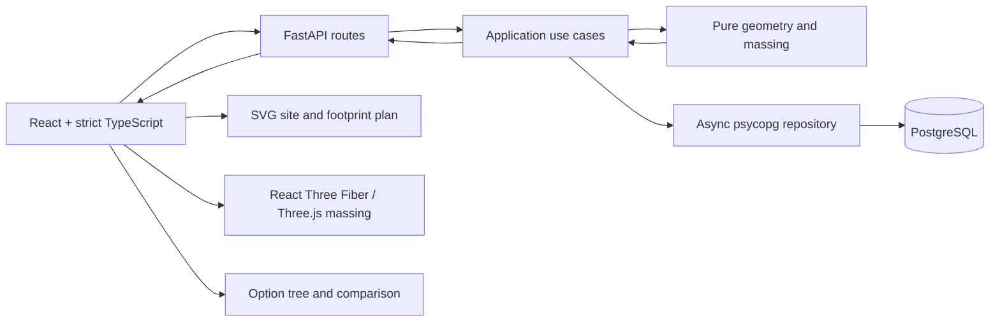

# Design note

> The application currently provides the health endpoint, configuration, async
> database-pool plumbing, sample sites, a tested TypeScript frontend scaffold, pure
> site geometry, setbacks, component selection, deterministic default footprint
> construction, maximum-permitted-floor calculation, default massing metrics,
> validated design preferences, preferred footprint construction, preference-aware
> massing metrics, validated GFA targets, target-driven floor selection, and target
> assessment. A typed massing preview API now exposes the domain result through
> explicit application mapping. PostgreSQL migrations, immutable root option saves,
> retrieval, and summary listing are implemented. Branching, tree traversal,
> comparison, alternatives, and visualization remain planned.

## Problem interpretation

The application turns one planar site polygon and building rules into a reproducible
massing option. The assignment requires generation, visualization, persistence, and
decision-tree branching, navigation, and comparison. It leaves the rendering approach
open. This design commits to both an SVG plan and an interactive 3D massing view:
complementary views of the same backend result, with both included in delivery scope.

The MVP produces one connected building. When setbacks split the site, the engine
preserves the complete buildable geometry, selects its largest connected component,
and reports the selection. Coordinates are
local metres; geographic conversion, richer zoning, authentication, multi-user
permissions, and background jobs are outside scope.

## Domain model

### Entities

- **SiteGeometry:** a valid, positive-area GeoJSON-style `Polygon`, optionally with
  holes. Coordinates are finite `(x, y)` metres; request rings are closed and
  orientation is normalized. Results support `MultiPolygon` setbacks; direct
  MultiPolygon site input is deferred.
- **HardConstraints:** non-negative `setback_m`, positive `floor_to_floor_m`, optional
  positive `max_height_m` and optional positive integer `max_floors`. Optional area
  limits are `site_coverage_ratio` in `(0, 1]` and positive `max_footprint_m2`.
  At least one height/floor limit is required.
- **FloorLimits:** the implemented immutable `app.massing` value object validates
  `floor_to_floor_m`, optional `max_height_m`, and optional `max_floors`. Its pure
  calculation returns the maximum permitted floor count without selecting a building.
- **FootprintLimits:** the implemented immutable domain value object accepts optional
  `site_coverage_ratio` and `max_footprint_area_m2` limits. HTTP uses
  `max_footprint_m2`, explicitly mapped to the existing domain field.
- **FootprintResult:** the implemented default-construction result contains the hard
  upper bound, generated Polygon and measured area when present, an outcome, the
  returned construction's secondary component metadata, and area undershoot.
- **DefaultMassingResult:** the implemented immutable result combines the canonical
  site, complete setback context, optional attempted footprint result, hard bounds,
  generated capacity, compact repeated-floor geometry, actual metrics, and a default
  feasibility outcome.
- **PreferenceMassingResult:** the implemented immutable result composes a
  `DefaultMassingResult`, validated `DesignPreferences`, validated `DesignTargets`,
  and an optional `FootprintAreaPreferenceResult`. It exposes the selected actual
  footprint, compact floor-plate metrics, target assessment, and preference-aware
  status.
- **DesignPreferences:** optional positive integer `preferred_floor_count` and
  positive `preferred_footprint_area_m2`; explicit choices subordinate to hard limits.
- **DesignTargets:** implemented immutable optional non-negative `gfa_target_m2`, a
  desired minimum, not a hard constraint or exact optimization objective.
- **MassingPreviewResponse:** typed HTTP configuration, context geometry, generated
  default and actual footprint, repeated floor plate, metrics, preference outcomes,
  and feasibility. Hard upper bounds, demonstrated construction capacity, and actual
  preferred results remain distinct.
- **Option:** immutable snapshot of inputs, result, schema/algorithm versions, and
  optional parent. A branch inherits the parent site, recomputes a complete new
  configuration, and inserts a child; it never updates its parent.
- **Diagnostic:** stable code, severity, message, and optional field/metric details.

### Measurement and invariants

The geometry engine measures polygon area as exterior area minus holes. Site area
uses the original boundary; `buildable_area_m2` sums all setback components, while
`selected_buildable_area_m2` measures only the component used for construction.
`footprint_area_m2` measures the actual resulting polygon, including any reduction
for coverage or preferences. Actual site coverage is `footprint_area_m2 / site_area_m2`;
the input `site_coverage_ratio` is its optional maximum, not the achieved value.

`floor_to_floor_m` is the uniform vertical spacing between successive floors.
The algorithm below derives the maximum permitted count from height/floor limits,
then selects the actual count. For repeated plates, GFA sums gross floor areas
without deductions for circulation or usable-space efficiency.

The footprint must be valid, positive, contained within the selected setback
component, and within all supplied area limits, using the numerical policy below.
Serialized geometry and reported area must agree. For a valid building:

- `height_m = floor_count * floor_to_floor_m`;
- `gfa_m2 = footprint_area_m2 * floor_count`;
- floor count is positive and respects both supplied height and floor limits.

A valid building may miss a target. A failed construction has no invented building
geometry or metrics. Snapshots retain every input and version needed for reproduction.

### Responsibilities and boundaries

FastAPI, PostgreSQL, async psycopg, and React are retained from the assignment scaffold.



Transport owns Pydantic contracts, versioning, and error translation; no geometry or
SQL. `app.application.massing.preview_massing` parses site input, calls the existing
preference-aware domain service, and explicitly maps the result to JSON-compatible
values without importing Pydantic or FastAPI. The root-save application use case
persists the server-computed preview with schema and algorithm metadata. Branch,
tree, and comparison use cases remain planned.
Pure domain services separate polygon operations from massing rules: `app.geometry`
owns polygons, while `app.massing.floors` owns scalar floor-limit rules and
`app.massing.defaults` orchestrates the current default result over those geometry
operations. `app.massing.configurable` composes the default result with exact floor
selection and preferred-area construction; `app.massing.metrics` centralizes the
arbitrary-precision metric multiplication used by both massing entry points. The
domain remains independent of HTTP and persistence. Repositories own parameterized
SQL, transactions, and snapshot mapping; no ORM. The frontend owns drafts,
interaction, and rendering; geometry, floor count, height, area, GFA, and feasibility
remain server-authoritative.

## Algorithm

### Geometry library and validation

[Shapely/GEOS](https://shapely.readthedocs.io/en/stable/reference/shapely.buffer.html)
provides validity, buffering, holes, and containment without requiring a database in
domain tests. Custom NumPy geometry would still require robust topology and offsets.
[Clipper2](https://www.angusj.com/clipper2/Docs/Overview.htm) offers integer-based
robustness but adds coordinate-scaling and Python-binding choices. PostGIS would
couple previews and geometry tests to PostgreSQL. GEOS floating-point behavior still
requires version pinning and numerical checks; successful buffering does not establish
optimality.

Validation covers types/bounds, finite coordinates, closed rings with at least three
unique points, positive area, and polygon validity. Self-intersections and collapsed
rings are rejected rather than silently repaired; orientation is normalized and
double-precision coordinates are preserved. Basic validation precedes hard
feasibility, then preference checks against calculated limits. Unsuccessful
construction is a domain outcome.

#### Implemented site geometry foundation

`app/geometry/site.py` exposes pure functions through `app.geometry`:
`parse_site_geometry` returns a normalized Shapely `Polygon`,
`serialize_site_geometry` returns a typed `PolygonGeoJSON` dictionary, and
`site_area_m2` measures exterior area minus holes. `normalize_polygon` validates
and applies the same canonicalization to directly supplied polygons, including
generated setback components. A Shapely polygon is the domain
value; no separate geometry wrapper, HTTP model, or database dependency is needed.
`InvalidSiteGeometry` carries a message and input path for transport translation.

The parser accepts a Polygon mapping with list/tuple coordinate arrays. Positions
must contain exactly two finite numeric ordinates; booleans and numeric strings
are rejected. Every ring needs at least three distinct vertices, exact closure in
the original numeric input, and finite positive area. The complete polygon must
have valid GEOS topology and finite positive area. Hole validity follows GEOS rules,
including valid single-point contacts. Empty geometry and direct MultiPolygon input
are rejected. Serialization and measurement also validate directly supplied Shapely
polygons, including rejecting Z/M dimensions. Validation never closes, snaps, or
repairs input geometry.

After validation, canonicalization removes exact consecutive duplicate positions
from exterior and interior rings using tuple equality (`itertools.groupby`). This
includes extra adjacent copies of the closing position and makes ring rotations
deterministic. All other coordinates, including distinct nearby and collinear
vertices, are retained. `shapely.remove_repeated_points(..., tolerance=0)` was
evaluated on the pinned engine, but it also removed a distinct `(1e-170, 0)` vertex;
exact equality avoids that coordinate loss without a geometric tolerance or repair.
Canonicalization then uses Shapely's
[`normalize`](https://shapely.readthedocs.io/en/stable/reference/shapely.normalize.html)
for consistent ring starts and hole ordering, followed by
[`orient_polygons`](https://shapely.readthedocs.io/en/stable/reference/shapely.orient_polygons.html)
for counter-clockwise exterior and clockwise interior rings. Serialization emits
closed list rings, normalizes signed zero, and performs no decimal rounding or
precision-grid reduction. Only exact consecutive duplicates are removed.
Coordinates use GEOS binary64 precision; large offsets or extremely small features
remain subject to floating-point limitations. Positivity and ring closure do not use
the later comparison tolerance, so there is no arbitrary minimum site area.

`pyproject.toml` pins Shapely **2.2.0**; `uv.lock` also locks its required NumPy
dependency to **2.5.4**. The local Python 3.12.14 macOS arm64 wheel installation reports
GEOS **3.14.1**. NumPy is transitive; the domain uses Shapely operations without custom
NumPy algorithms. GEOS is bundled with Shapely wheels rather than resolved as a
separate Python package; source builds can link a different GEOS version. Reproduction
should record both `shapely.__version__` and `shapely.geos_version_string`; identical
results across different engine versions are not guaranteed.

Tests close copies of the supplied open vertex-list fixtures before parsing, checking
rectangle, L-shaped, and notched areas of 1000, 900, and 860 m² respectively. Additional
cases cover holes, invalid topology/coordinates, tiny positive sites, deterministic
ordering, and exact coordinate/area preservation through JSON round trips.

### Setbacks and floor limits

```python
buildable = site.buffer(-setback_m, join_style="mitre", mitre_limit=5)
```

Mitred joins preserve rectilinear corners; the limit bounds acute-angle spikes.
The result is normalized to valid Polygon, MultiPolygon, or empty geometry. The engine
preserves complete `buildable_geometry` and selects its largest positive-area component,
breaking ties by lexicographic bounding box then normalized serialized coordinates.
The response includes component count, retained/discarded area, and selection
diagnostics. Rejecting every split would discard useful sites; using every component
would introduce multi-building allocation.

#### Implemented setbacks and component selection

`app/geometry/setbacks.py` implements `calculate_setback(site, setback_m)` as a pure
function returning a frozen `SetbackResult`. The site is validated before buffering;
the distance must be a finite, non-negative numeric value, excluding booleans and
numeric strings. Invalid distances raise `InvalidSetback`. Zero setback bypasses
`buffer(0)` to preserve the foundation's canonical representation, including distinct
collinear vertices. Positive distances use the mitred inward buffer above.

The result keeps the complete Shapely Polygon/MultiPolygon and a separate selected
Polygon. It reports original site area, total buildable area, selected area, component
count, and discarded area in square metres; retained area aliases selected area.
Discarded area sums unselected components directly to avoid losing tiny components
through subtraction. An empty result contains an empty Polygon, selected geometry
`None`, zero buildable/selected/retained/discarded areas, and zero components. The
original site area remains available.

`select_largest_component` accepts valid positive-area Polygon candidates and ignores
empty polygons. Components use exact descending computed area, then ascending bounds,
then canonical numeric coordinate arrays. Comparison tolerance does not turn unequal
areas into ties or discard positive components. `normalize_polygon` and
`serialize_site_geometry` supply the existing normalization policy for every component.
`serialize_buildable_geometry` emits a Polygon or MultiPolygon dictionary with parts
in the same deterministic order; empty regions serialize as `None`. Buildable
geometry retains every strictly positive measured component, with no minimum area
cutoff.

Diagnostics use stable code, severity, and message fields:
`EMPTY_BUILDABLE_REGION` (`info`) and `BUILDABLE_REGION_SPLIT` (`warning`). They describe
geometry outcomes without introducing massing feasibility statuses. Invalid generated
geometry, non-finite measurements, or invariant failures raise errors rather than
being converted into empty-region diagnostics. Area conservation and non-growth use
the centralized comparison tolerance described below and implemented in
`app/geometry/tolerances.py`; they do not modify returned geometry. Nonempty output
must satisfy `site.covers(buildable)`, which permits shared boundary points. Any
spatial escape is an invariant failure regardless of its area; an outside-area
threshold alone cannot bound displacement. No containment relaxation is applied.

The pinned GEOS 3.14.1 engine can collapse or reshape extremely thin regions before
their ideal mathematical area reaches zero. For a 20 × 10 m rectangle and a 4.99995 m
setback, it returns a valid contained triangle of approximately 0.000500005 m² rather
than the ideal thin rectangle of approximately 0.00100001 m². A unit square inset by
0.499995 m returns empty despite an ideal positive area near 1e-10 m². Tests preserve
positive output below the comparison tolerance and verify ordinary analytical inset
geometry. These near-collapse results are reported as produced by GEOS, without
snapping, a custom repair, or a claim of exact mathematical erosion at every scale.

#### Implemented default footprint construction

`app/geometry/footprints.py` exposes `generate_footprint(setback, limits)` and the
frozen `FootprintResult`. Its `footprint_area_upper_bound_m2` reuses the hard-area
calculation: the minimum of selected buildable area, original site area multiplied
by `site_coverage_ratio`, and `max_footprint_area_m2`. The internal field name is
`max_footprint_area_m2`; the HTTP route explicitly maps `max_footprint_m2` to it.

When the selected canonical Polygon already fits the bound, the result returns that
canonical Polygon directly without `buffer(0)`, preserving holes and distinct
collinear vertices. Otherwise, the generator applies mitred inward buffers to the
original selected component. It derives a finite bracket from the component extent,
expands it at most eight times until an empty result is verified, then evaluates a
fixed 48-iteration binary search. Midpoint stagnation and non-finite arithmetic stop
the search. Every candidate is canonicalized and validated, must remain covered by
the original component, and is eligible only when its measured area is at or below
the hard bound. The largest admissible candidate actually evaluated is returned.

`FootprintResult.secondary_component_count` and
`secondary_discarded_area_m2` describe the construction associated with the returned
footprint; they are not cumulative search-iteration totals. A direct successful
construction reports one component and zero discarded area. `undershoot_m2` is the
hard-bound area minus the returned measured area. Outcomes are `success`,
`empty_buildable_region`, and `generation_failed`; unsuccessful outcomes contain
`None` geometry and area. Unexpected GEOS errors, invalid generated topology, and
invariant violations propagate as errors rather than becoming ordinary failures.

#### Implemented floor-limit calculation

Let `N = maximum_permitted_floor_count` denote the hard upper bound returned by
`calculate_maximum_permitted_floor_count(limits)`.

`app.massing` exposes the immutable `FloorLimits` value object, the
`InvalidFloorLimits` domain exception, and
`calculate_maximum_permitted_floor_count(limits)`. `floor_to_floor_m` is required
and must be a finite positive number. `max_height_m` is optional and, when supplied,
must use the same validation. `max_floors` is optional and must be a strictly
positive Python integer; booleans, floats, strings, zero, and negative values are
rejected. Every supplied field is validated, and at least one of the two optional
limits must be present. Integer length inputs are normalized to Python `float`;
`max_floors` retains integer semantics.

The calculation uses `floor(max_height_m / floor_to_floor_m)` for a height-only limit,
`max_floors` for a count-only limit, and the smaller value when both are supplied.
It returns a non-negative integer hard upper bound. A valid positive height below one
floor therefore returns zero; zero is a capacity result, not invalid input and not a
claim that this scalar module has assigned the application's full `infeasible` status.
The default massing orchestration uses this capacity as its actual floor count when a
valid default building can be constructed. Preference-aware orchestration can retain
that count, honor an explicit floor preference, or select the minimum count that
fulfills a positive GFA target.

This is a pure massing rule and does not depend on Shapely, site geometry, HTTP,
Pydantic, or persistence.

### Area bounds and deterministic construction

`U = footprint_area_upper_bound_m2` is the minimum of the largest setback component's
area, supplied `site_area_m2 * site_coverage_ratio`, and supplied
`max_footprint_area_m2` in the current internal API. The HTTP contract calls
the last field `max_footprint_m2`. The footprint module does not calculate GFA, but
default massing derives `gfa_upper_bound_m2 = U * N` from this bound and the floor
capacity. These are necessary hard upper bounds under the adopted single-building,
setback, and repeated-plate conventions, not promises of attainable geometry.

The engine uses the selected component when its area fits `U`; otherwise it searches
inward-buffer distances with the extent-derived bracket and fixed iteration budget
described above. Each distance applies to the original selected component. After
validation and largest-component selection using the same tie-break, the search
retains the largest valid candidate actually generated at/below `U`, reporting
secondary splits, discarded area, and undershoot.

This default is `generated_footprint_geometry`, with `generated_footprint_area_m2` and
`generated_gfa_capacity_m2 = generated_footprint_area_m2 * N`. Capacity demonstrates
one attainable construction; it is not the maximum permitted by hard constraints.
If no positive valid default is generated despite positive buildable area and floors,
the result is `generation_failed` / `FOOTPRINT_NOT_GENERATED`; capacity is unknown
(`null`), not zero.

A measured dumbbell fixture uses two 20 × 20 m lobes joined by a 2 m corridor, a zero
setback, and a 350 m² cap. On Python 3.12.14 with Shapely 2.2.0 and GEOS 3.14.1,
the implementation returns a valid contained Polygon of
`323.9999999999905 m²`, with two construction components, equal discarded area, and
`26.000000000009493 m²` undershoot. Independently, `box(0, 0, 20, 17.5)` is a valid
connected 350 m² rectangle covered by the selected component. This demonstrates a
larger admissible footprint than this inward-buffer heuristic constructs; it does not
make the generated area a mathematical maximum. Failure of this heuristic does not
prove geometric impossibility.

Inward buffering reuses a mature operation, reduces search to one dimension, and
supports direct containment checks. Centroid scaling can escape concave regions;
axis clipping adds an arbitrary direction and can split; inscribed rectangles
restrict shapes; general optimization adds objectives and complexity. The MVP accepts
and reports undershoot without adding an optimizer.

#### Implemented default massing orchestration

`app.massing` exposes `generate_default_massing(site, *, setback_m,
footprint_limits, floor_limits)` and the immutable `DefaultMassingResult`. The
orchestration first validates and canonicalizes the original Polygon, calculates the
complete `SetbackResult`, derives `N` with
`calculate_maximum_permitted_floor_count`, and calculates the hard footprint bound
`U`. It preserves the complete buildable geometry, selected component, split
diagnostics, and footprint construction metadata in the nested results.

When the selected buildable region is empty, the result is `infeasible` with reason
`EMPTY_BUILDABLE_REGION`. When `N` is zero, it is `infeasible` with reason
`ZERO_PERMITTED_FLOORS`. An empty selected region takes precedence when both
conditions apply. In both cases footprint construction is skipped and
`footprint_result` is `None`. If a positive region and positive floor capacity are
available, the existing deterministic generator is attempted. Its
`generation_failed` outcome becomes `generation_failed` / `FOOTPRINT_NOT_GENERATED`
with `hard_constraints_satisfied = null`; this is not a proof of mathematical
infeasibility. A failed or skipped result has null generated capacity and null actual
footprint, floor-plate geometry, area, floor count, height, GFA, and coverage.

A successful default uses all `N` permitted floors and the generated footprint. The
floor plate is represented compactly as one Polygon plus `floor_count` and
`floor_to_floor_m`; no per-floor Polygon or 3D mesh is produced. The actual metrics
are `height_m = floor_count * floor_to_floor_m`,
`gfa_m2 = footprint_area_m2 * floor_count`, and
`site_coverage_ratio = footprint_area_m2 / site_area_m2`. The hard
`gfa_upper_bound_m2 = U * N` and generated `generated_gfa_capacity_m2` remain
separate: the latter is evidence of one construction returned by the heuristic, not
an optimality certificate. A valid default is `feasible`; target assessment is part of
the preference-aware entry point described below.

The public `NumericalRangeError` is raised when a required height or area-times-count
metric cannot be represented as a finite float. Metric multiplication keeps the
arbitrary-precision integer floor count intact until the final conversion, including
the case where a very large count multiplied by a small positive value remains
finite. This error behavior is an implementation decision for the current domain
slice, not an explicit employer requirement.

#### Implemented preference-aware massing orchestration

`app.massing` exposes `generate_massing_with_preferences(site, *, setback_m,
footprint_limits, floor_limits, preferences, targets=None)` and the immutable
`PreferenceMassingResult`. The result composes the complete `default_result` context
with validated preferences and targets, optional `area_preference_result`, and the
selected actual footprint, compact floor plate, floor count, height, GFA, coverage,
status, reason, hard-constraint outcome, and `target_assessment`.

The default result establishes outcome precedence. An empty selected buildable region
is `infeasible` with `EMPTY_BUILDABLE_REGION`, including when floor capacity is also
zero. A positive region with zero permitted floors is `infeasible` with
`ZERO_PERMITTED_FLOORS`; both cases skip preference construction and return null
actual building metrics. With positive capacity, an explicit floor preference is
validated against `N` before preferred-area construction; exceeding `N` raises
`PreferenceExceedsHardLimit` rather than clamping.

When no area preference is supplied, the generated default footprint is used. A
preferred area uses the existing deterministic inward-buffer construction and its
measured Polygon. Successful `met`, `clamped`, and `approximated` area outcomes
satisfy hard constraints; overall massing status is `feasible` or
`feasible_target_unmet` according to the GFA target assessment. The nested preference
result preserves the request, effective target, measured area, signed difference, and
diagnostic codes. A failed
preferred construction produces `generation_failed` with
`PREFERRED_FOOTPRINT_NOT_GENERATED`, null selected metrics, and no fallback to the
default footprint. A failed default construction can still yield a feasible preferred
building when the separate preferred construction succeeds; without an area
preference, the default failure is preserved.

Actual height and GFA use the selected floor count and measured footprint area. The
hard GFA bound and generated default capacity remain unchanged in `default_result`.
Both entry points reuse the same exact stored-float-by-integer metric helper, so large
integer floor counts and `NumericalRangeError` behavior remain consistent.

### Preferences and floor selection

A floor preference is an exact discrete choice: exceeding `N` returns
`422 PREFERENCE_EXCEEDS_HARD_LIMIT` rather than silently changing it. Area is a
continuous construction request already subject to approximation. For requested
area `R`, the engine searches the original selected component with target `min(R, U)`;
`PREFERENCE_CLAMPED_TO_HARD_CAP` applies only when `R > U` beyond tolerance.
An area request within `U` but above `generated_footprint_area_m2` is not a hard-cap
violation.

Area results retain `requested`, `effective`, `actual`, and signed
`difference_m2 = actual - requested`. Positive candidates are `met` within tolerance,
`clamped` for requests above `U`, otherwise `approximated`; clamped results also expose
effective-target undershoot. `FOOTPRINT_AREA_APPROXIMATED` reports construction
discrepancies. If preferred construction produces no positive polygon, the result is
`generation_failed` / `PREFERRED_FOOTPRINT_NOT_GENERATED`, with preference status
`unmet` and actual area null. Context, bounds, and known default capacity remain
available; the default never silently replaces the request.

Without a floor preference, the preference-aware entry point uses `N` when the target is
absent or zero, and otherwise selects the minimum permitted count whose measured GFA
fulfills the target. A preferred footprint is constructed first, so target selection
uses its measured area. Explicit floor preferences remain unchanged even when a target
is unmet; an unmet target is reported as `feasible_target_unmet` while hard constraints
remain satisfied.

### Feasibility and targets

`generate_default_massing` and `generate_massing_with_preferences` implement
`feasible`, `infeasible`, and `generation_failed` around the pure geometry and
floor-limit operations. The preference-aware entry point additionally returns
`feasible_target_unmet` when a valid building misses a supplied target. It validates
preference types and floor capacity after empty-region/zero-floor precedence, then
applies the selected area and floor choices without changing hard bounds or generated
default capacity.

| Status | Meaning | `hard_constraints_satisfied` |
|---|---|---|
| `feasible` | Positive valid building; target met or absent. | `true` |
| `feasible_target_unmet` | Positive valid building; target missed. | `true` |
| `infeasible` | Empty setback region or no permitted floor. | `false` |
| `generation_failed` | Positive region/floors, but construction yielded no valid positive footprint; no proof of hard infeasibility. | `null` |

Empty setbacks report `EMPTY_BUILDABLE_REGION`.

For a valid building with an unmet target, classify in order using tolerance:

1. `TARGET_EXCEEDS_UPPER_BOUND`: target exceeds `gfa_upper_bound_m2`; unreachable
   under the documented hard constraints and model, although the building remains valid.
2. `TARGET_BEYOND_GENERATED_CAPACITY`: within the upper bound but above generated
   capacity; another footprint may work.
3. `TARGET_UNMET_WITH_PREFERENCES`: default capacity suffices, but the actual selected
   configuration falls short. This diagnoses the result without inferring user intent.

Target status is `not_requested` when absent, `met`/`unmet` for positive buildings,
and `not_evaluated` for supplied targets without a building. Zero is met only with a
positive building. When the default footprint generator has no measured capacity but a
preferred footprint succeeds, an unmet target keeps its assessment without inventing a
generated-capacity diagnostic.

### Numerical policy and alternatives

Geometry and area comparisons use centralized scale-aware tolerances: initially area
tolerance `max(1e-8, 1e-9 * max(site_area_m2, 1))`, length tolerance derived from
extent, and GFA tolerance propagated through `N` and conservatively capped at
`1e-9 * comparison_scale_m2`. Floor-limit arithmetic uses a separate exact policy.
Length inputs are first normalized to Python floats, then
`Fraction.from_float` represents those stored binary64 values exactly; it does not
recover the original decimal text. This avoids intermediate float quotient overflow
and prevents rounding from admitting an over-height floor. No epsilon, `isclose`, or
area tolerance authorizes an extra floor, and `max_floors` is never converted through
float.

For example, `10.0 / 2.5` permits four floors. With stored values
`max_height_m=36.0` and `floor_to_floor_m=3.6`, the result is nine: ten exact copies
of the stored `3.6` exceed the stored height even though ordinary rounded float
multiplication displays `10 * 3.6 == 36.0`. A height of `nextafter(36.0, inf)` permits
ten. This is the current engineering choice, not an explicit employer requirement.
If exact decimal or fixed-unit semantics are needed later, they require an explicit
input contract before API integration. Rounded display values must not silently become
the authority for accepting floor counts.

Default massing preserves the arbitrary-precision integer count when deriving height,
GFA capacity, GFA, and the hard GFA bound. Each required derived metric must remain a
finite reportable float; otherwise `NumericalRangeError` is raised instead of
returning infinity or NaN, clamping the count, or classifying the case as geometric
infeasibility. This range-error behavior is an implementation decision for the
current slice, not an explicit employer requirement.

The same target predicate governs floor selection and final status; when a minimum count
exceeds one, the preceding count must fail it. Tolerance cannot bridge material capacity
gaps or certify ungenerated geometry; adjustments require fixture evidence.

After the manual save/branch workflow works, optional bounded suggestions enumerate
counts `1..N`, request `target / count` area for positive targets, otherwise use the
default footprint. Suggestions reuse construction/validation, have a count cap, and
are deduplicated by count and area tolerance. Failed candidates are reported as
skipped; an empty suggestion set does not prove infeasibility. Suggestions remain
unsaved previews without ranking or broader optimization.

## Persistence and migration strategy

### Stored versus derived

Drafts and previews are transient. Saving persists the site, constraints, preferences,
target, and server-derived geometry, metrics, and diagnostics together with versions
and a parent link. The engine derives results from inputs; storing those results
preserves the exact historical option without rerunning a potentially changed engine.
Recorded inputs and pinned algorithm dependencies support reproduction.

JSONB snapshots keep complete inputs/results together without joins across mutable
configuration rows. More normalization reduces duplication and improves analytics,
but adds joins and version coordination. Small immutable snapshots favor self-contained
reads, with application validation and schema versions for nested invariants.

The implemented schema is defined by the numbered SQL migration
[`001_create_options.sql`](../backend/app/sql/migrations/001_create_options.sql).
`options` stores UUID identity and optional parent foreign key, name, positive schema
version, algorithm version, JSONB configuration/result snapshots, feasibility status,
and a timezone-aware creation timestamp. The parent foreign key restricts deletion;
indexes cover parent lookup and deterministic creation-time/UUID listing. A database
check requires the indexed status to agree with the result's feasibility status.

`uv run app migrate` verifies SHA-256 checksums and the installed history, then
applies pending SQL and ledger entries atomically. A transaction advisory lock is
acquired before ledger creation so concurrent first installations also serialize.
Changed, missing, or reordered installed migrations are rejected; applied files must
remain immutable. Docker startup runs the command before launching Uvicorn workers;
migrations never execute in worker lifespan hooks. See the
[database setup instructions](../backend/README.md#database-setup-and-migrations).

`app.persistence.options.OptionRepository` uses parameterized SQL,
JSONB adapters, and explicit transactions for inserts, retrieval, and bounded summary
listing. Inserts generate UUIDs and derive the indexed status from the result. An
outer transaction retains commit ownership through nested savepoints. Reads return
stored values without calling the geometry engine, and summaries select metadata
and metrics without loading full geometry. Listing uses descending creation time
and UUID, with limit/offset pagination. Future database permissions or an append-only
trigger can reinforce immutability against direct SQL writes. Root saves set
`schema_version=1` and record a massing-policy version plus the runtime Shapely and
GEOS versions in `algorithm_version`. The policy version must change when algorithm
behavior changes. Saved results preserve historical interpretation without promising
identical recomputation across changed geometry-engine versions. Breaking snapshot
schema changes will require compatible readers or explicit migration.

## API contract

All routes use `/api/v1`; breaking changes require a new version, additive response
fields remain compatible. Preview, root save, option retrieval, and option listing
are implemented. Branching, tree, comparison, and alternatives remain planned.
Preview and root-save requests require `site` and
`hard_constraints`. Omitted `preferences` and `targets` default to empty objects;
explicit null objects are invalid. Optional scalar fields accept null. Unknown fields,
including client-computed results, are rejected. Root saves also accept an optional
nullable `name`, trimmed and limited to 1–200 characters without NUL when supplied.
A root request cannot supply a parent identifier.

Computed preview example, also exercised through the OpenAPI example:

```json
{
  "site": {
    "type": "Polygon",
    "coordinates": [[[0, 0], [40, 0], [40, 25], [0, 25], [0, 0]]]
  },
  "hard_constraints": {
    "setback_m": 3, "floor_to_floor_m": 3.5,
    "max_height_m": 24, "max_floors": 6
  },
  "preferences": {},
  "targets": {"gfa_target_m2": 2000}
}
```

This produces a 646 m² footprint, four floors, 14 m height, and 2584 m² GFA,
with status `feasible` and target status `met`. The hard and generated GFA capacity
are both 3876 m² at six permitted floors. `/docs` exposes the request/response
schemas and example; `/openapi.json` exposes the machine-readable schema.

| Method and path | Contract |
|---|---|
| `POST /massing/preview` | Complete configuration → domain result, HTTP `200`. |
| `POST /options` | Recompute and save root → complete snapshot, `201`. |
| `POST /options/{option_id}/branches` | Parent site plus complete new constraints/preferences/targets → child snapshot, `201`. |
| `GET /options` | Summary array; `limit` (default 50, maximum 200) and `offset` (default 0). |
| `GET /options/{option_id}` | Complete immutable snapshot. |
| `GET /options/tree?root_id=...` | Tree of option summaries. |
| `POST /options/compare` | Selected options → snapshots and input/metric/diagnostic comparison. |
| `POST /massing/alternatives` | Secondary bounded suggestions; no persistence. |

`POST /options` uses the same configuration conversion, preview computation, and
error translation as the preview endpoint, then inserts one snapshot transactionally.
It returns `201` with a `Location` header and a complete snapshot containing `id`,
null `parent_id`, name, schema/algorithm versions, timezone-aware `created_at`, configuration
(`site_geometry`, `hard_constraints`, `preferences`, `targets`),
`feasibility_status`, and the full preview under `result`. Repeated saves always
create separate roots. Retrieval returns the stored snapshot without recomputation;
listing returns metadata and metrics, newest first with UUID as a tie-breaker.
Offset pagination is intended for this small prototype; concurrent inserts may shift
page boundaries. Parent/root filters are deferred with the branching workflow.

Results echo normalized configuration (including the canonical site) and return
`site_geometry`, `buildable_geometry`,
`selected_buildable_geometry`, `generated_footprint_geometry`, `footprint_geometry`,
and `floor_plate_geometry` using closed-ring GeoJSON-style geometry. `metrics` contains
site/buildable/selected areas (`site_area_m2`, `buildable_area_m2`,
`selected_buildable_area_m2`), `footprint_area_upper_bound_m2`, `gfa_upper_bound_m2`,
`generated_footprint_area_m2`, `generated_gfa_capacity_m2`,
`maximum_permitted_floor_count`, and actual `footprint_area_m2`, `floor_count`,
`height_m`, `gfa_m2`, `site_coverage_ratio`, and `floor_to_floor_m`. `setback`
contains `component_count`, `retained_area_m2`, and `discarded_area_m2`.
`preference_results` contains the requested `preferred_floor_count` and a nullable
`footprint_area` assessment with the domain's requested/effective/actual areas,
signed difference, effective-target undershoot, status, and diagnostic codes.
`feasibility` contains status, nullable reason, hard-constraint satisfaction, target
assessment (`requested_m2`, `actual_m2`, `shortfall_m2`, status, `diagnostic_code`),
and diagnostics with code, severity, message, and optional path/details.

All four domain statuses use preview `200` and root-save `201`, including diagnostic
snapshots. For `infeasible`/`generation_failed`, actual footprint/floor-plate geometry,
area, count, height, and GFA are null; retain available context/bounds. Empty buildable
geometry is null; generated capacity is null if no default was constructed. Persisted
status must agree with result. Clients cannot submit authoritative computed results.

Errors use `{error: {code, message, details: [{path, message}]}}`. Validation is `422`:
`INVALID_SITE_GEOMETRY`, `INVALID_CONSTRAINTS`, `INVALID_PREFERENCE`,
`INVALID_TARGET`, or `PREFERENCE_EXCEEDS_HARD_LIMIT`. Malformed/non-positive
preferences use `INVALID_PREFERENCE`; absent height and floor limits use
`INVALID_CONSTRAINTS`. Invalid GFA targets use `INVALID_TARGET`. Malformed JSON,
invalid root bodies, and unknown root fields use `INVALID_REQUEST`. For multiple
invalid sections, the code identifies the first validation error in schema order;
details retain all field paths and messages, without input values or exception
contexts. Paths use dotted fields and bracketed array indexes.

Numbers must be finite JSON numeric values, excluding booleans and strings. Floor
counts require integers; coordinates preserve original integers until domain ring
validation, then use the existing binary64 canonicalization without rounding.
Floor-limit and GFA tolerances remain the domain policies above. A required derived
metric outside finite binary64 range returns `422 NUMERICAL_RANGE_ERROR`, never
infeasibility or non-finite JSON. Unexpected geometry failures remain server errors.
Preview computation runs through FastAPI's worker thread pool and performs no
database operation. Root saves compute through the same function before repository
insertion; database operations use the existing async pool. Pool shutdown runs even
when application lifespan exits with an error. Preview tests need no database;
option tests use isolated disposable PostgreSQL databases, also supplied in CI.

Missing option UUIDs return `404 OPTION_NOT_FOUND` through the same error envelope;
malformed UUIDs and invalid pagination use `422 INVALID_REQUEST`. Database failures
remain server errors and failed inserts roll back. Planned comparison validation
uses `INVALID_COMPARISON`, and planned missing parents use `PARENT_OPTION_NOT_FOUND`.

The UI preserves requested drafts, shows floor errors inline and requested/effective/
actual area differences. Failed construction clears stale building views; users can
revise preferences, explicitly request the default, or save the diagnostic snapshot.

## Visualization

### Exploration workspace

The screen combines a configuration form, plan/massing views, metrics and diagnostics,
and option-tree navigation with comparison. A user previews a configuration, saves
it, changes floor or footprint preferences in a draft, previews the change, and saves
a child option. Selecting saved alternatives restores their corresponding results in
both views; unsaved previews remain clearly separate from saved history.

### Types and state

A separate TypeScript PR enables `strict: true` before features, preserving health
checks and adding typed API/environment boundaries, typecheck, lint, tests, and build checks.
[Strict checking](https://www.typescriptlang.org/tsconfig/strict.html) exposes null
geometry and inconsistent statuses across forms/renderers more reliably than
JavaScript/JSDoc, but does not replace runtime or geometric validation.

[TanStack Query](https://tanstack.com/query/latest/docs/framework/react/overview)
owns remote previews/options and cache lifecycle. Fetch/effects would repeat that
logic across consumers. Configuration keys must prevent stale responses replacing
the current preview; configure retries deliberately, especially save mutations.

[React Hook Form](https://react-hook-form.com/get-started) owns editable drafts,
dirty state, errors, and submission; [Zod](https://zod.dev/) provides typed parsing
and cross-field checks. Handwritten controlled forms duplicate these concerns;
client validation still must match server rules. Interaction state starts locally or
in lifted state/context. Zustand is justified only when independent tree/comparison/
viewer controls require shared subscriptions; forms/stores never mirror query results.

### SVG plan and interactive 3D massing

SVG suits the prototype's small set of site, setback, selected-component, and footprint
layers. Vector paths and even-odd hole fills preserve spatial relationships under a
shared, aspect-preserving transform with screen y-axis inversion. DOM events support
interaction without custom hit-testing. Canvas becomes attractive for large geometry
sets but needs explicit redraw, hit-testing, and accessibility. SVG still requires
bounded vertex complexity and accessible metric/diagnostic text alongside the plan.

The 3D view helps architects read volume, floor count, and height that overlap in a
plan, making footprint/height trade-offs easier to judge. It complements precise plan
inspection; basic interactive 3D is part of this design's delivery scope, with visual
polish deferred.

[React Three Fiber](https://r3f.docs.pmnd.rs/getting-started/introduction) integrates
Three.js with React's result/selection lifecycle; direct Three.js requires imperative
scene synchronization and teardown. Fiber still requires compatible React versions,
correct hole conversion, and explicit resource ownership.

The viewer renders individually addressable extruded floors using returned heights
and vertical positions, with orbit/zoom controls, fitted camera, floor separation,
and site/footprint context. Polygon holes become shape holes; complete setback
MultiPolygons appear as outlines, with no buildings on discarded components. Loading,
empty, invalid, and unsupported geometry have explicit states. Resource disposal and
reuse of unchanged meshes limit rendering overhead.

Both views consume one backend-generated result to keep plan, volume, and reported
metrics aligned. The frontend transforms geometry for
display; it does not recalculate authoritative polygons, height, footprint area, or GFA.

### Option Decision Tree & Navigation

Decision-tree exploration is a core assignment requirement. The first saved massing
becomes a root option (`parent_id = null`). Branching from a saved node creates a
child with that node's ID as its parent and a newly computed configuration. Repeating
this action from the same parent creates sibling alternatives. Immutable snapshots
keep earlier decisions stable for comparison and prevent a later edit from changing
the meaning of an existing branch.

A lightweight hierarchical React list presents expandable branches, option labels,
status cues, and native selection buttons. This fits a small, single-parent history
without graph layout or drag-to-connect interactions. [React Flow](https://reactflow.dev/)
supports richer node-based interfaces, but its graph interaction model and dependency
are unnecessary for this prototype. A simple list requires deliberate keyboard/focus
behavior and becomes less useful for very large trees; richer navigation can follow
observed need.

Selecting a node loads its saved constraints, preferences, target, geometry, metrics,
and feasibility into the workspace. Draft edits create a new preview rather than
modifying that snapshot. Separate comparison selection lets users inspect saved
alternatives' inputs, metrics, and diagnostics side by side while switching the
active geometry view between them.

PostgreSQL stores the tree through the existing `options.parent_id` links. On reload,
list/tree endpoints supply saved summaries and parent relationships to reconstruct
the hierarchy; the get endpoint supplies the selected snapshot. History therefore
survives independently of browser state, without duplicating the snapshot model.

## Open implementation decisions

Validate the selected Shapely/GEOS versions against setback fixtures; establish
narrow-geometry tolerance behavior; choose explicit migration CLI versus an additional
guarded startup check; verify Three.js holes and camera framing against the selected
versions. These are implementation validations, not additional product scope.

## Assumptions & trade-offs

Uniform repeated floor plates approximate GFA without architectural layout or
building-code compliance. Largest-component selection and inward buffering favor
predictability over optimal utilization; generated capacity is evidence, not an
optimality certificate. Preferences remain explicit even when they reduce target
achievement. Basic 2D/3D and manual exploration take priority over suggestions,
visual polish, or optimization.

## Edge cases

The algorithm contracts above govern empty/split setbacks, missing floor limits,
preference clamping/failure, and the three distinct target-shortfall cases. Additional
checks preserve holes through construction/serialization, reject malformed or
degenerate rings, and apply scale-aware boundary comparisons. Missing parents insert
no child. Unsupported 3D geometry shows an explicit error while keeping available 2D
context; failed requests must never display stale successful massing.

## Testing strategy

Use rectangle, concave/L-shaped, notched, holed, split, near-empty, degenerate, and
self-intersecting fixtures. Check validity, containment, coverage, deterministic
selection, geometry/metric round trips, floor/height bounds, and minimal-floor target
selection at tolerance edges. A measured dumbbell fixture plus an independently
contained 350 m² polygon must distinguish heuristic undershoot from hard infeasibility.

Cover absent/zero targets, both omitted floor limits, excessive floors versus clamped
areas, targets between generated GFA capacity and its hard bound, and construction failure
with null fields. Verify all status/diagnostic branches and preference preservation.

API/database tests cover validation, all snapshot statuses, transactional save/branch,
unchanged parents, sibling branches, tree/comparison, and reload using disposable
PostgreSQL. Frontend checks cover strict types, lint/build, forms, stale responses,
keyboard tree navigation, node selection/comparison, null-state rendering, and matching
SVG/3D geometry, floors, holes, and resource lifecycle.

The Docker Compose milestone exercises site → preview → manual changes → save →
branch → reload → compare, including both views and invalid, split, infeasible, and
generation-failed cases. Correctness comes from invariants and independent fixtures,
not illustrative API numbers.

## Roadmap

1. Add site-specific zoning once the core geometry contract is stable to support
   more realistic briefs.
2. Improve the chosen 2D/3D views' performance and selection feedback based on measured use.
3. Extend bounded suggestions with user-selected ranges after manual exploration is
   reliable, reducing repetitive comparisons.
4. Introduce optimization only after agreeing objectives and explainable trade-offs.
5. Support multiple buildings with explicit component allocation and separate stacks.
6. Add exact option diffs, algorithm-version migration, and provenance as saved
   histories grow, making changes easier to audit.
7. Add caching, spatial indexes, or background computation only when measurements
   justify them.
